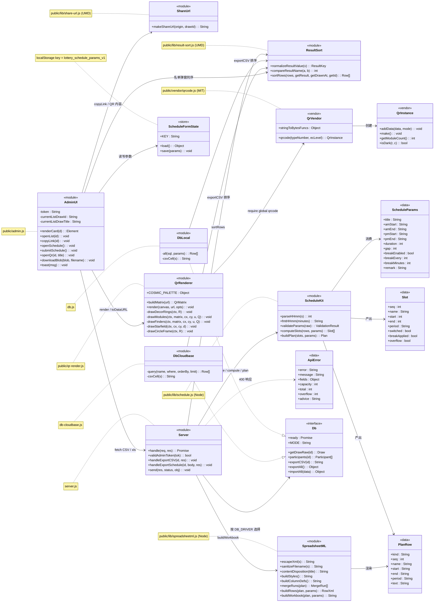
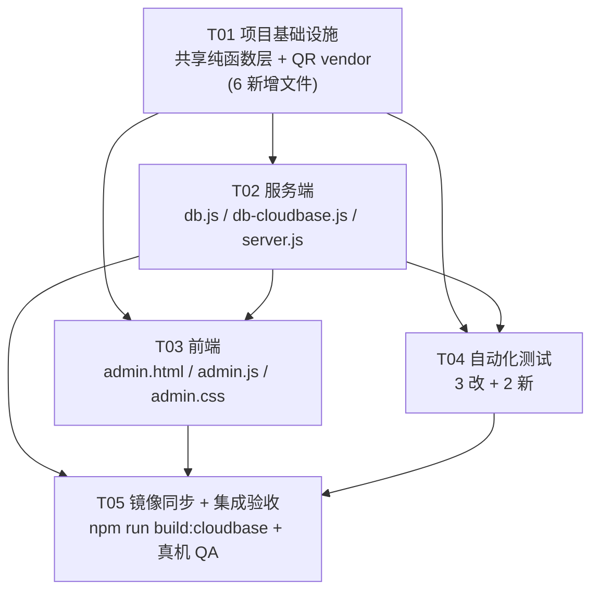

# 抽签系统 · 增量系统设计：导出名单排序 / 发言顺序表 / 分享二维码

| 项 | 内容 |
|---|---|
| 文档类型 | 增量系统设计 + 有序任务列表（工程师施工图） |
| 版本 / 状态 | v1.0 / 已定稿，可直接施工 |
| 编制 | 高见远（架构师） · 2026-11-06 |
| 上游输入 | `docs/PRD-增量-导出与分享.md`（365 行，已完整读取） |
| 基线 | `lottery-app@1.1.0`；Node.js 内置 http + 原生 JS 前端；唯一 npm 依赖 `@libsql/client` |
| 本次范围 | F1 导出名单排序修正 / F2 新增「导出发言顺序」`.xls` / F3 新增「分享二维码」 |
| 拍板结论 | PRD §10 Q1–Q11 由主理人裁定，Q12 / Q13 由本设计定稿（见 §1.2、§6、§7）；**不再向用户抛任何待确认项** |
| 硬约束 | 不改数据库 schema、不新增录入字段、不改抽签算法、**不新增 npm 依赖**、**不改部署配置**（Dockerfile / render.yaml / cloudbaserc / 环境变量）、禁止硬编码域名 |

> **本设计的两条地基性结论（先读）**
>
> 1. **所有新增 JS 一律放在 `public/` 目录下**（`public/lib/`、`public/vendor/`、`public/qr-render.js`）。实地核对发现：`Dockerfile:13` 是 `COPY db.js server.js migrate-to-turso.js ./`，**根目录新增 `lib/` 不会被打进 Render 镜像**；而 `Dockerfile:14` 的 `COPY public ./public` 与 `build-cloudbase.js:35,39` 的 `copyDir(PUBLIC, ...)` 都会递归复制 `public/`。同时 `server.js:65-71` 的 `serveStatic` 对 `/vendor/qrcode.js`、`/lib/xxx.js` 解析正确（已用 Node 实测：`/vendor/qrcode.js → <root>\public\vendor\qrcode.js`，`startsWith(PUBLIC_DIR)=true`，扩展名 `.js` 命中 `application/javascript`）。→ **因此本次无需修改 `Dockerfile`、无需修改 `build-cloudbase.js`、无需改 `package.json`，镜像副本依然能全量自动同步。**
> 2. **排序只有一份实现**：`public/lib/result-sort.js` 写成 UMD（Node `module.exports` + 浏览器 `window.ResultSort`），同时被 `db.js`、`db-cloudbase.js`、`server.js`、`public/admin.js` 引用。F1（CSV）、F2（.xls）、P1-1（名单弹窗）三处逐行一致，从构造上保证 AC-1.7 / AC-2.14 / P1-1。

---

## 1. 实现方案总览

### 1.1 三个功能的实现路径

| 功能 | 改动面 | 核心做法 |
|---|---|---|
| **F1 名单导出按结果升序** | 数据层 + 名单弹窗 | `db.js:285`、`db-cloudbase.js:264` 的 `exportCSV` 去掉对 `drawn_at` 排序的依赖，改为 `all()/query()` 取原始行后调用 `ResultSort.sortRows()`；SQL / 查询仍保留 `ORDER BY drawn_at` 作为**稳定兜底**，真正决定顺序的是纯函数。`GET /api/admin/draws/:id/export` 路由、BOM、表头、文件名、鉴权**全部不动**。P1-1：`admin.js:186-199 openList()` 用同一 `ResultSort` 排序后再渲染表格。 |
| **F2 导出发言顺序 `.xls`** | 服务端新接口 + 前端新弹窗 | 新增 `POST /api/admin/draws/:id/export-schedule`；服务端 `lib/schedule.js` 做参数校验 / 时间排程 / 容量预演算，`lib/spreadsheetml.js` 拼 Excel 2003 SpreadsheetML XML 字符串；前端 `#scheduleModal` 收集 11 个字段，fetch → blob → `a.download`。参数记忆用 `localStorage`（P1-2）。 |
| **F3 分享二维码** | 纯前端 | vendor 一份 MIT 单文件 QR 编码器到 `public/vendor/qrcode.js`；`public/qr-render.js` 用离屏 Canvas 分层绘制；`admin.js` 卡片新增第 7 个按钮 `data-act="qr"` → `#qrModal` 展示 / 复制 / 下载 PNG。码内容由 `ShareUrl.makeShareUrl(location.origin, id)` 单一来源生成。不改 `cosmic-bg.js` 本体。 |

### 1.2 关键技术选型表（含被否决方案与理由）

| 决策点 | **选定方案** | 被否决方案 | 否决理由 / 依据 |
|---|---|---|---|
| **Q12 `.xls` 生成位置** | **服务端新增 `POST /export-schedule`** | 前端生成 `.xls`（PRD Q12 备选） | AC-2.14 要求「F1 CSV 与 F2 .xls 人员顺序逐行一致」。前端生成要么复制一份排序实现，要么新增接口拉取已排序行——前者产生两套逻辑必然分歧，后者多一次往返却仍要服务端排序。服务端单点持有 `ResultSort` 是最短路径。另外服务端生成便于 `selftest-*.js` 纯 Node 单测排程与 XML，无需浏览器环境。 |
| **Q12 `.xls` 技术格式** | **Excel 2003 SpreadsheetML XML（XMLSS）**，扩展名 `.xls`，`Content-Type: application/vnd.ms-excel` | ① HTML-Table `.xls`；② 真 BIFF8 二进制 `.xls`（手写 OLE2 + BIFF 记录）；③ OOXML `.xlsx`；④ 引入 `exceljs` / `xlsx` | ① HTML-Table 依赖 `colspan/rowspan` + 内联 CSS，Excel/WPS 对合并单元格边框与底色的还原不一致，且**同样会触发**「格式与扩展名不一致」提示，还更易被安全软件判为 HTML；无一项优于 XMLSS。② BIFF8 虽能彻底消除提示，但需手写 OLE2 复合文档 + ~20 种 BIFF 记录（含 XF/PALETTE/MERGEDCELLS），约 400+ 行且难测，收益/风险不匹配。③ `.xlsx` 是 ZIP 包，Node 无内置 zip 实现，零依赖下需手写 deflate + ZIP 目录，成本过高，且用户明确要 `.xls`。④ 用户已拍板「不引入新依赖」。XMLSS 用 `ss:MergeAcross` / `ss:MergeDown`、`<Interior ss:Color>`、`<Borders>`、`<Column ss:Width>`、`<Row ss:Height>` **原生声明式**表达全部排版需求，纯字符串拼接即可，零依赖、可单测、Excel 2003+ / WPS 均可读。 |
| **Q12 「格式与扩展名不一致」提示** | **诚实说明 + 三重缓解**，不承诺 100% 消除 | 声称 XMLSS `.xls` 无提示 | 实证：Excel 2007+ 对「XML 内容 + `.xls` 扩展名」按文件头嗅探，普遍弹出该提示（StackOverflow 30391879 / 29478524 明确记录 SpreadsheetML 存成 `.xls` 会触发）。缓解：① 紧贴 XML 声明之后写 `<?mso-application progid="Excel.Sheet"?>`（Windows/Excel 按 ProgID 绑定，部分环境可直接静默打开）；② 精确 `application/vnd.ms-excel` + `attachment`；③ XML 声明带 `encoding="UTF-8"`。**该提示是「是 / 否」一次性确认、非阻断**，点「是」后样式与合并单元格完整保留；WPS 通常不弹。AC-2.7 的措辞是「不出现……**阻断**」，符合。QA 必须在 Excel + WPS 双开实测记录；若用户后续要求零提示，唯一零依赖解法是改扩展名 `.xml`（违反用户拍板的 `.xls`）或启用真 BIFF8，均需新一轮拍板，本次不做。 |
| **Q13 QR 编码** | **vendor `kazuhikoarase/qrcode-generator` 单文件 `js/dist/qrcode.js`（MIT）** | ① 手写最小 QR（字节模式 + 版本自适应 + RS 纠错 H）；② 引入 `qrcode` npm 包；③ 用在线二维码 API | ① 手写需完整 `RS_BLOCK_TABLE`（40 版本 × 4 纠错等级）、GF(256) 运算、掩码选择、格式/版本信息，约 500+ 行且极易出隐性解码 bug，与「微信/相机真机可扫」的硬指标冲突；仅在 vendor 无法获取时才退化，本次**已实测可获取**，故不退化。② 违反零新增依赖。③ 引入外部网络依赖与隐私/可用性风险，且线上域名未定。详见 §7.1。 |
| **共享排序实现放置** | `public/lib/result-sort.js`（UMD 双环境） | 根目录 `lib/`；写进 `db.js` 再由 `db-cloudbase.js` 复用 | 见「地基性结论 1」：根目录新增文件不会进 Docker 镜像；`db-cloudbase.js` 在 CloudBase 云函数里与 `db.js` 不同时存在，无法互相 require。UMD 还顺带让 P1-1 的浏览器弹窗复用**同一份**比较逻辑。 |
| **分享 URL 构造** | `public/lib/share-url.js`（UMD 单函数 `makeShareUrl`） | 在 `admin.js` 里内联拼接 | AC-3.2 要求「解码结果 == 剪贴板字符串」逐字符相同；抽出单一函数后，卡片「复制链接」、弹窗「复制链接」、二维码内容、弹窗链接文本、Node 单测**全部调用同一函数**，由构造保证一致，且 `location.origin` 动态适配 localhost / Render / 正式域名（Q11）。 |
| **中心星空图色值** | 在 `public/qr-render.js` 顶部集中定义 `COSMIC_PALETTE` 常量对象，**不改 `cosmic-bg.js`** | 抽独立 `cosmic-palette.js` 并让 `cosmic-bg.js` 引用 | `cosmic-bg.js` 是两个带 DOM 副作用 + `requestAnimationFrame` 死循环的 IIFE，复用需重构本体（PRD D18 明确不改）。抽独立文件却只有 `qr-render.js` 一个消费者，等于多一个无收益模块。故不抽公共文件，仅在 `qr-render.js` 用注释标注「色值与 `cosmic-bg.js` 同步，改动需双改」，QA 人工比对。详见 §7.4。 |
| **二维码可扫性**（Q6） | **可扫性优先**：三个 7×7 finder pattern 保持标准实心方块、全部模块完整绘制且**从不使用 `ctx.clip()`**；「同心圆」画在 QR 层**之下**的外圈装饰带；「圆形」= 白色圆形底 + 圆形描边，QR 方阵内接于该圆 | 同心圆替换定位角 / 圆形裁剪四角 / 放射短线 | 主理人 Q6 裁定：不得替换、不得裁切模块。任何 finder 变体必须先过真机解码门禁才允许采用（默认关闭）。详见 §7.2。 |

### 1.3 架构模式

沿用现有「**无框架、CommonJS 模块 + 路由函数 + 原生 DOM 事件**」风格，不引入 MVC/MVVM 框架。新增代码按「**纯函数层 → 适配层 → 集成层**」三层组织：

```
纯函数层（可 Node 单测、无 IO）   public/lib/{result-sort, share-url, schedule, spreadsheetml}.js
        ↑ require（Node） / <script>（浏览器）
适配层（IO / 平台）              db.js / db-cloudbase.js / server.js / public/admin.js / public/qr-render.js
集成层（装配）                   public/admin.html（script 顺序、弹窗 DOM）、public/admin.css
```

---

## 2. 模块划分与完整文件清单

### 2.1 新增文件（8 个）

| # | 路径 | 类型 | 职责 | 被谁引用 |
|---|---|---|---|---|
| N1 | `public/lib/result-sort.js` | UMD 纯函数 | `normalizeResultValue` / `compareResultName` / `sortRows`；F1、F2、P1-1 唯一排序口径 | `db.js`、`db-cloudbase.js`、`server.js`、`admin.js`、`selftest-schedule.js` |
| N2 | `public/lib/share-url.js` | UMD 纯函数 | `makeShareUrl(origin, drawId)`；唯一分享链接来源 | `admin.js`（copyLink / QR / 链接文本）、`selftest-qr.js` |
| N3 | `public/lib/schedule.js` | CommonJS 纯函数 | `parseHHmm` / `fmtHHmm` / `validateParams` / `computeSlots` / `buildPlan`（含容量预演算） | `server.js`、`selftest-schedule.js` |
| N4 | `public/lib/spreadsheetml.js` | CommonJS 纯函数 | `escapeXml` / `buildStyles` / `buildColumnDefs` / `buildRows` / `buildWorkbook` / `contentDisposition` / `sanitizeFilename` | `server.js`、`selftest-schedule.js` |
| N5 | `public/vendor/qrcode.js` | 第三方 vendor（MIT，浏览器 + CommonJS） | QR 矩阵生成（含完整 Reed-Solomon、40 版本、L/M/Q/H） | `public/qr-render.js`（浏览器 `window.qrcode`）、`selftest-qr.js`（Node `require`） |
| N6 | `public/qr-render.js` | 浏览器 IIFE | `COSMIC_PALETTE`、`buildMatrix`、Canvas 分层渲染 `render(canvas, url, opts)`、PNG 导出 | `admin.js` |
| N7 | `selftest-schedule.js` | Node 测试 | 排程算法 / 校验 / 容量 / SpreadsheetML XML 结构单测 | QA、`node selftest-schedule.js` |
| N8 | `selftest-qr.js` | Node 测试 | vendor QR 矩阵不变量、finder pattern、URL 构造、finder 完整性与无裁切静态断言 | QA、`node selftest-qr.js` |

> N5 vendor 的完整 MIT 许可正文以注释块形式追加在文件头（保留上游原始 MIT 头 verbatim），**不额外新增 LICENSE 文件**，保证「单文件 vendor」与镜像同步的最简面。

### 2.2 修改文件（9 个主文件）

| # | 路径 | 改动内容 | 涉及 AC |
|---|---|---|---|
| M1 | `db.js` | 顶部 `require('./public/lib/result-sort')`；`exportCSV`（L285-293）SELECT 增加 `id` 列（仅作稳定兜底键，不输出），去掉对 `drawn_at` 的顺序依赖，改为 `sortRows(...)` 后再拼 CSV | AC-1.1~1.8 |
| M2 | `db-cloudbase.js` | 同 M1；`query()` 调用显式传 `limit = 10000`（**消除默认 `limit(1000)` 与 `db.js` 无上限的行为差异**，见 §12 R4）；`participants()` 同样显式传 `limit = 10000` | AC-1.7 / AC-2.14 |
| M3 | `server.js` | 顶部 `require('./public/lib/{result-sort, schedule, spreadsheetml}')`；在 **L113 鉴权之后**、L171 CSV 路由附近新增 `POST /api/admin/draws/:id/export-schedule` 分支；新增 `safeFilename` 辅助。**`GET /export` 路由 L171-182 一行不改** | AC-2.x |
| M4 | `public/admin.html` | ① `#listModal` 底部 `.modal-foot` 增加「导出发言顺序」按钮 `#scheduleBtn`；② 新增 `#scheduleModal`；③ 新增 `#qrModal`；④ `<body>` 末尾按序插入 5 个 `<script>`（见 §8.1） | F2 / F3 |
| M5 | `public/admin.js` | ① `renderCard` 的 `.dc-actions` 新增第 7 个 `<button data-act="qr">`；② `copyLink()` 改调 `ShareUrl.makeShareUrl`；③ `openList()` 用 `ResultSort.sortRows` 排序并缓存 `currentListDrawTitle`；④ `exportBtn` 保持原样；⑤ 新增 `#scheduleBtn` / `#scheduleModal` 表单逻辑 + localStorage；⑥ 新增 `#qrModal` 逻辑 + PNG 下载 | 全部 |
| M6 | `public/admin.css` | `.modal-box.wide`、`.fld-grid` / `.fld.err` / `.fld-msg`、`.form-error`、`#schError`、`.qr-url`、`.qr-canvas`、`.dc-actions` 7 按钮窄屏换行、`[data-act=qr]` 强调样式 | F2 / F3 / P1-4 |
| M7 | `selftest.js` | ① 第 5 段补 CSV 排序断言（造 `5 / 13 / 38`、非数字、空值、同值 `drawn_at`）；② **新增第 11 段：CloudBase 镜像 SHA-256 一致性断言**（见 §10 T05） | AC-1.1~1.9 / AC-3.9 / P0-8 |
| M8 | `selftest-http.js` | 第 7 段后新增 `export-schedule` 冒烟：200 + XML 头 + 关键单元格、400 非法参数、400 容量超限；并断言 CloudBase 桥接 base64 解码后 XML 正确 | AC-2.10 / AC-2.12 |
| M9 | `selftest-server.js` | `runMode()` 内新增一次真实 HTTP 的 `export-schedule` 成功 + 400 冒烟（local 与 turso 两种模式都跑） | AC-2.x 回归 |

**不改动（明确列出，防止误改）**：`package.json`、`package-lock.json`、`Dockerfile`、`.dockerignore`、`render.yaml`、`cloudbaserc.example.json`、`build-cloudbase.js`、`cloudbase/function/{index.js,http-bridge.js,package.json}`、`public/cosmic-bg.js`、`public/index.html`、`public/user.js`、`public/user.css`、`public/user.css` 的所有镜像、`db.js` 的 `exportAll/importAll`（`version:1` 顺序不变）、抽签算法 `performDraw`、数据库 schema。

### 2.3 镜像同步文件（由 `npm run build:cloudbase` 生成，**禁止手工编辑**）

`build-cloudbase.js:32-42` 已覆盖全部新增文件（`rmrf(FN/public)` + `copyDir(PUBLIC, FN/public)`；`rmrf(HOST)` + `copyDir(PUBLIC, HOST)`；`admin.html → HOST/admin/index.html`），因此**脚本本身无需修改**。生成的镜像清单：

| 主文件 | 镜像路径（同步后必须逐字节一致） |
|---|---|
| `db-cloudbase.js` | `cloudbase/function/db-cloudbase.js` |
| `server.js` | `cloudbase/function/server.js` |
| `public/admin.html` | `cloudbase/function/public/admin.html`、`cloudbase/hosting/admin.html`、`cloudbase/hosting/admin/index.html` |
| `public/admin.js` | `cloudbase/function/public/admin.js`、`cloudbase/hosting/admin.js` |
| `public/admin.css` | `cloudbase/function/public/admin.css`、`cloudbase/hosting/admin.css` |
| `public/qr-render.js` **（新）** | `cloudbase/function/public/qr-render.js`、`cloudbase/hosting/qr-render.js` |
| `public/lib/result-sort.js` **（新）** | `cloudbase/function/public/lib/result-sort.js`、`cloudbase/hosting/lib/result-sort.js` |
| `public/lib/share-url.js` **（新）** | `cloudbase/function/public/lib/share-url.js`、`cloudbase/hosting/lib/share-url.js` |
| `public/lib/schedule.js` **（新）** | `cloudbase/function/public/lib/schedule.js`、`cloudbase/hosting/lib/schedule.js` |
| `public/lib/spreadsheetml.js` **（新）** | `cloudbase/function/public/lib/spreadsheetml.js`、`cloudbase/hosting/lib/spreadsheetml.js` |
| `public/vendor/qrcode.js` **（新）** | `cloudbase/function/public/vendor/qrcode.js`、`cloudbase/hosting/vendor/qrcode.js` |
| `public/cosmic-bg.js`（不改） | `cloudbase/function/public/cosmic-bg.js`、`cloudbase/hosting/cosmic-bg.js`（重建后应逐字节一致） |
| `public/index.html` / `user.js` / `user.css`（不改） | `cloudbase/function/public/*`、`cloudbase/hosting/*`（重建后应逐字节一致，AC-3.10） |

> **唯一同步动作**：改完主文件后执行 `npm run build:cloudbase`，再用 `node selftest.js` 第 11 段的 SHA-256 断言兜底。禁止手工逐份改 `cloudbase/**`。

---

## 3. 公共排序纯函数设计（F1 / F2 / P1-1 唯一实现）

### 3.1 模块与签名

文件：`public/lib/result-sort.js`，**UMD**（Node 走 `module.exports`，浏览器挂 `window.ResultSort`），无任何 `require`、无 DOM、无 IO、无全局状态。

```js
// 伪代码 / 接口契约
ResultKey = { kind: 0|1|2, num: Number, text: String }
  // kind 0 = 有限数字（Number(v) 非 NaN 且 isFinite，且 trim 后非空）
  // kind 1 = 非空但非数字文本（如「一等奖」「A03」）
  // kind 2 = null / undefined / '' / 全空白

normalizeResultValue(v) -> ResultKey
compareResultName(a, b) -> -1 | 0 | 1          // 只比较「结果值」本身
sortRows(rows, getResult, getDrawnAt, getId) -> Row[]   // 返回新数组，不改原数组、不改行对象
```

### 3.2 比较规则（对应 PRD §4.1，优先级严格递减）

| 序 | 规则 |
|---|---|
| 1 | 按 `ResultKey.kind` 升序：`0 数字` < `1 非数字文本` < `2 空值` |
| 2 | kind=0：`num` 数值升序（`"5" < "13" < "38" < "43"`）；**不是字符串比较** |
| 3 | kind=1：`text.localeCompare(other.text, 'zh-CN')` 字典序 |
| 4 | 前 3 条相等 → 次级键 `Number(getDrawnAt(row))` 升序（`NaN`/`null` → `0`），即「先抽者在前」 |
| 5 | 仍相等 → `String(getId(row))` 字典序（**保证 `db.js` 与 `db-cloudbase.js` 在完全同值同时间时也逐行一致**，见 AC-1.7） |
| 6 | 仍相等 → 原始下标（decorate-sort-undecorate，稳定排序） |

`Number()` 判定前必须 `String(v).trim()`：`" 5 "` → 5；`"Infinity"` / `"NaN"` / `"1e999"` 视为非数字（kind 1）；`"0x10"` 视为非数字（`Number` 会得 16，为防意外，仅接受 `/^[+-]?(\d+\.?\d*|\.\d+)([eE][+-]?\d+)?$/` 形态的字符串才走数值分支）。

### 3.3 三处（实际四处）复用方式

| 调用点 | 行数据形态 | 调用写法 | 说明 |
|---|---|---|---|
| `db.js:exportCSV` | `{id, name, result_name, drawn_at}` | `sortRows(rows, r => r.result_name, r => r.drawn_at, r => r.id)` | SQL 仍 `ORDER BY drawn_at`，仅作稳定兜底；SELECT 增加 `id` 但不输出 |
| `db-cloudbase.js:exportCSV` | 同上（`query()` 已 `strip(_id)`、保留 `id`） | **完全相同**的调用 | `query(..., ['drawn_at','asc'], 10000)` |
| `server.js:/export-schedule` | `db.participants()` → `{id, name, resultName, drawnAt}`（camelCase） | `sortRows(parts, p => p.resultName, p => p.drawnAt, p => p.id)` | **字段名不同，必须显式传 accessor**，禁止直接把行对象塞进通用比较器 |
| `public/admin.js:openList` | 同 camelCase | `ResultSort.sortRows(list, p => p.resultName, p => p.drawnAt, p => p.id)` | P1-1 所见即所得 |

> **AC-2.14 保障**：CSV 与 `.xls` 都走 `sortRows`，且两处数据源的 `(result, drawnAt, id)` 三元组完全相同（同一张 `participants` 表），故逐行一致。`selftest-schedule.js` 与 `selftest.js` 各加一条「同一造数下 CSV 行序 === .xls 姓名列顺序」的交叉断言。

### 3.4 伪代码

```text
FUNCTION sortRows(rows, getResult, getDrawnAt, getId):
    decorated = rows.map((row, i) => ({
        row, i,
        key  : normalizeResultValue(getResult(row)),
        time : Number(getDrawnAt(row)) || 0,
        id   : String(getId(row) == null ? '' : getId(row))
    }))
    decorated.sort((A, B) => {
        IF A.key.kind != B.key.kind: RETURN A.key.kind - B.key.kind
        IF A.key.kind == 0 AND A.key.num != B.key.num: RETURN A.key.num - B.key.num
        IF A.key.kind == 1:
            c = A.key.text.localeCompare(B.key.text, 'zh-CN')
            IF c != 0: RETURN c
        IF A.time != B.time: RETURN A.time - B.time
        IF A.id != B.id: RETURN A.id < B.id ? -1 : 1
        RETURN A.i - B.i
    })
    RETURN decorated.map(d => d.row)
```

---

## 4. 排程算法设计（`public/lib/schedule.js`，服务端唯一实现）

### 4.1 输入参数结构

```js
ScheduleParams = {
  title: String,          // 必填，trim 后 1..60 字
  amStart: 'HH:mm',       // 默认 '08:40'
  amEnd:   'HH:mm',       // 默认 '12:00'
  pmStart: 'HH:mm',       // 默认 '14:00'
  pmEnd:   'HH:mm',       // 默认 '17:30'
  duration: Int,          // 默认 10，必须 > 0
  gap: Int,               // 默认 5，必须 >= 0（0 = 无缝衔接）
  breakEnabled: Boolean,  // 默认 true（Q2）
  breakEvery: Int,        // 默认 7，启用时必须 >= 1
  breakMinutes: Int,      // 默认 15，启用时必须 >= 0
  remark: String          // 默认见下表，可清空 / 改写，<= 200 字
}
```

**默认值（Q1 / Q2 / Q3 / Q4 裁定）**

| 字段 | 默认值 | 备注 |
|---|---|---|
| amStart / amEnd / pmStart / pmEnd | `08:40 / 12:00 / 14:00 / 17:30` | Q1 |
| duration / gap | `10 / 5` | 步长 `S = D + G = 15` |
| breakEnabled / breakEvery / breakMinutes | `true / 7 / 15` | Q2，还原示例第 7 人后休息 |
| 休息后下一位 | `开始 = 上一位结束 + M`，**覆盖 G、不叠加** | Q3，复现 `10:20 → 10:35` |
| remark | `1、个人答辩时长每人13分钟，其中报告呈现10分钟，评委提问3分钟。` | Q4：原样沿用示例文案且允许改写。⚠️ **示例备注写「13 分钟」，而排程时长为 10 分钟，属示例固有的不一致，用户可自行改写备注**，系统不自动纠正、不做一致性校验 |
| title | 打开表单时取当前抽签 `title` | **不写入 localStorage**（切换场次必须刷新），见 §8.4 |

### 4.2 时间运算

- `parseHHmm(s)`：严格 `/^([01]\d|2[0-3]):[0-5]\d$/`，返回 `h*60 + m`（整数分钟 `0..1439`）；非法返回 `NaN`。
- `fmtHHmm(n)`：`String(Math.floor(n/60)).padStart(2,'0') + ':' + String(n%60).padStart(2,'0')`；`n > 1439` 时仍按绝对分钟格式化（不取模，便于 QA 看出越界），但容量校验会拦截。
- **全流程内部只用整数分钟**，仅在 `computeSlots` 产出 `PlanRow` 时转 `HH:mm` 字符串；日期/时区不参与运算（无跨天排程，PRD §8）。
- 校验（服务端权威，前端镜像）：
  - 四个时间格式合法；`amEnd > amStart`；`pmStart > amEnd`（即 `pmStart <= amEnd` 非法）；`pmEnd > pmStart`
  - `duration` 为整数且 `> 0`（建议上限 600）
  - `gap` 为整数且 `>= 0`
  - `breakEnabled` 为布尔；启用时 `breakEvery` 整数 `>= 1`、`breakMinutes` 整数 `>= 0`
  - `title` 必填 `<= 60`；`remark` `<= 200`；剔除 `\r\n` 之外的控制字符
  - 任一条失败 → `{ ok:false, error:'invalid_params', fields:{ amStart:'…', duration:'…' } }` → HTTP 400

### 4.3 两阶段算法（先算槽位，再插分隔行）

**阶段 A：`computeSlots(sortedRows, params)`** —— 纯时间推演，不产出表格行。

```text
D = duration; G = gap; M = breakMinutes; N = breakEvery
period = 'am'
lastEnd = null
sinceBreak = 0          // 本段/本休息周期内已连续排入人数
pendingBreak = false    // 下一位是否要走「+M」覆盖规则

FOR i = 0 .. rows.length-1:
    IF i == 0:
        start = (period == 'am') ? amStart : pmStart
    ELSE IF pendingBreak:
        start = lastEnd + M                 // Q3：覆盖 G，不叠加
    ELSE:
        start = lastEnd + G
    end = start + D

    switched = false; breakApplied = pendingBreak
    IF period == 'am' AND end > amEnd:       // 上午排满 → 自动接下午
        period = 'pm'; switched = true
        breakApplied = false                 // D17：午休优先于课间休息
        start = pmStart; end = start + D
        sinceBreak = 0

    overflow = (period == 'pm' AND end > pmEnd)
    slots.push({ seq: i+1, name: rows[i].name, start, end,
                 period, switched, breakApplied, overflow })

    lastEnd = end
    pendingBreak = false
    IF NOT overflow:
        IF switched:            sinceBreak = 1        // 下午段重新起算（D17）
        ELSE IF breakApplied:   sinceBreak = 1        // 休息后开启新计数周期
        ELSE:                   sinceBreak += 1
        IF breakEnabled AND sinceBreak >= N AND i < rows.length-1:
            pendingBreak = true                       // 还有下一位才插休息行
```

**阶段 B：`buildPlan(slots, params)`** —— 插入分隔行、容量判定、行号推进。

```text
plan = []; emittedLunch = false; Z = 0
FOR s IN slots:
    IF s.overflow: Z += 1; CONTINUE                  // 只计数，不出行
    IF s.switched AND NOT emittedLunch:
        plan.push({ kind:'lunch', text:'午休' }); emittedLunch = true
    ELSE IF s.breakApplied:
        plan.push({ kind:'break', text:`课间休息${M}分钟` })
    plan.push({ kind:'person', seq:s.seq, name:s.name,
                start:fmtHHmm(s.start), end:fmtHHmm(s.end), period:s.period })
plan.push({ kind:'remark', text: params.remark })   // 备注为空仍生成行

Y = slots.length; X = Y - Z
IF Z > 0: RETURN { ok:false, error:'capacity_exceeded',
                   capacity:X, total:Y, overflow:Z,
                   advice:'建议缩短发言时长 / 间隔，或延长下午结束时间' }
ELSE: RETURN { ok:true, rows: plan, personCount: Y, params }
```

> **Q10 落地**：容量判定用「对真实数据做一次完整预演算」，`X = Y − Z`（可安排人数 = 总人数 − 越界人数）。因休息行只在「还有下一位」时才插入，截断到 X 人不会产生额外休息开销，故 X 人必然可排，提示中的 X / Y / Z 自洽。**Z > 0 时不生成任何文件**，返回 400 结构化错误体，前端在 `#schError` 展示「当前时间参数最多可安排 X 人，当前 Y 人，超出 Z 人。建议……」并保持弹窗打开。

**A 列时段纵向合并的索引计算**（在 `buildPlan` 尾部完成，供 §6 使用）：

把 `plan` 中的 `person` 行按「连续且未被 `break` / `lunch` / `remark` 整行合并打断」切成若干 run；每个 run 的首行 A 单元格写 `ss:MergeDown = run.length - 1` + 文案（`period == 'am' ? '上午' : '下午'`），run 内其余行**不输出 A 单元格**，其 B 单元格带 `ss:Index="2"`。`break` / `lunch` / `remark` 行本身用 `ss:MergeAcross="6"` 独占整行，因此天然成为 run 的分界 → **不会出现纵向合并与横向合并重叠**（Excel 打开报错的常见坑）。

### 4.4 示例推演表（默认参数，7 人 + 第 8 人）

排序后姓名按结果升序：`宋亚轩(5) / 贾玉婵(6) / 宋白(13) / 林漪挺(14) / 刘耀文(17) / 白敬亭(38) / 张真源(43)`。

| 序号 | 姓名 | 结果 | 段 | 本行开始的计算 | 开始 | 结束 | 备注 |
|---:|---|---|---|---|---|---|---|
| 1 | 宋亚轩 | 5 | 上午 | 首位 = `amStart` = 08:40 | 08:40 | 08:50 | |
| 2 | 贾玉婵 | 6 | 上午 | `08:50 + G(5)` | 08:55 | 09:05 | |
| 3 | 宋白 | 13 | 上午 | `09:05 + 5` | 09:10 | 09:20 | |
| 4 | 林漪挺 | 14 | 上午 | `09:20 + 5` | 09:25 | 09:35 | |
| 5 | 刘耀文 | 17 | 上午 | `09:35 + 5` | 09:40 | 09:50 | |
| 6 | 白敬亭 | 38 | 上午 | `09:50 + 5` | 09:55 | 10:05 | |
| 7 | 张真源 | 43 | 上午 | `10:05 + 5` | 10:10 | 10:20 | 排完 `sinceBreak = 7 = N`，且还有第 8 人 → `pendingBreak = true` |
| — | **课间休息15分钟** | — | — | 跨 7 列合并行 | — | — | 蓝底白字 |
| 8 | （第 8 人） | — | 上午 | `10:20 + M(15)`（**覆盖 G**，不叠加 5） | **10:35** | 10:45 | AC-2.1 / AC-2.2 复现 |

- 相邻两人开始差 = `D + G = 15` 分钟 ✓
- 休息处开始差 = `D + M = 25` 分钟（`10:10 → 10:35`）✓
- 7 人数据**不会**出现休息行（无下一位，`i < rows.length-1` 为假）；AC-2.1 需造 ≥ 8 人数据。
- 上午切下午：`end > amEnd(12:00)` 时插「午休」行、`start` 重置为 `14:00`、`seq` 连续不重置、`sinceBreak` 归零（D17）。

---

## 5. 新增 API 契约

### 5.1 `POST /api/admin/draws/:id/export-schedule`

| 项 | 值 |
|---|---|
| 路径 | `/api/admin/draws/:id/export-schedule`（`id` 为 `base64url`，正则同现有 `^\/api\/admin\/draws\/([^/]+)\/…$`） |
| 方法 | `POST` |
| 鉴权 | **必须放在 `server.js:113` 的 `validAdminToken` 之后**；请求头 `x-admin-token: <HMAC token>`；缺失/伪造 → `401 {"ok":false,"message":"未授权，请先登录"}` |
| 请求头 | `Content-Type: application/json` |
| 请求体 | `ScheduleParams`（§4.1），11 个字段全量传入；未知字段忽略 |
| 成功 | `200`，二进制/文本 XMLSS 字节流 |
| 失败 | `400` / `401` / `404` / `500`，JSON |

**Request 示例**

```json
{
  "title": "2026年度答辩发言顺序",
  "amStart": "08:40", "amEnd": "12:00",
  "pmStart": "14:00", "pmEnd": "17:30",
  "duration": 10, "gap": 5,
  "breakEnabled": true, "breakEvery": 7, "breakMinutes": 15,
  "remark": "1、个人答辩时长每人13分钟，其中报告呈现10分钟，评委提问3分钟。"
}
```

**Response 200 头**

```http
HTTP/1.1 200 OK
Content-Type: application/vnd.ms-excel
Content-Disposition: attachment; filename="schedule.xls"; filename*=UTF-8''2026%E5%B9%B4%E5%BA%A6%E7%AD%94%E8%BE%A9%E5%8F%91%E8%A8%80%E9%A1%BA%E5%BA%8F-%E5%8F%91%E8%A8%80%E9%A1%BA%E5%BA%8F.xls
```

- `filename="<ASCII 回退名>"` + `filename*=UTF-8''<encodeURIComponent(中文名)>`（RFC 6266 / 5987 双形式，`filename*` 必须放最后）。现代 Chrome / Edge / Firefox / Safari 优先采用 `filename*`，得到 `<title>-发言顺序.xls`；旧客户端回退到 `schedule.xls`。
- `sanitizeFilename(title)`：先 `trim`，剔除 `"` `\` `/` `:` `*` `?` `<` `>` `|`、CR/LF 与 C0 控制字符，长度上限 80 字；防头部注入（Node 不允许非 latin1 头值，故中文必须走 `filename*` 百分号编码）。
- **保持 `GET /export` 现有的 `filename="<encodeURIComponent(title)>-名单.csv"` 写法一字不改**（AC-1.8）。
- 前端 `a.download` 直接用表单里的 `title + '-发言顺序.xls'`，不解析响应头（AC-2.12）；服务端 `filename*` 服务于直接调用/非浏览器客户端。
- ⚠️ **CloudBase 桥接注意**：`cloudbase/function/http-bridge.js:68-74` 的 `toResult()` 把 `application/vnd.ms-excel` 判为非文本 → body 以 base64 返回并置 `isBase64Encoded:true`。这是**正确行为**（网关解码后字节不变），务必不要改成 `text/xml`。`selftest-http.js` 需断言 `Buffer.from(body,'base64').toString('utf8')` 以 `<?xml` 开头。

**Response 200 体**：UTF-8 编码的 XMLSS 字符串（**不加 BOM**，靠 `<?xml version="1.0" encoding="UTF-8"?>` 声明编码），骨架见 §6.3。

**Response 400 错误体**

```json
// 参数非法
{
  "error": "invalid_params",
  "message": "时间参数或发言节奏设置不合法",
  "fields": { "duration": "每人发言时长必须大于 0 分钟", "pmStart": "下午开始时间必须晚于上午结束时间" }
}
// 容量超限（Q10，不生成文件）
{
  "error": "capacity_exceeded",
  "message": "当前时间参数最多可安排 18 人，当前 24 人，超出 6 人。建议缩短发言时长 / 间隔，或延长下午结束时间",
  "capacity": 18, "total": 24, "overflow": 6,
  "advice": "建议缩短发言时长 / 间隔，或延长下午结束时间"
}
// 名单为空
{ "error": "no_participants", "message": "暂无参与记录" }
```

| HTTP | error | 触发 |
|---|---|---|
| 400 | `invalid_params` | `validateParams` 任一字段失败（含 `duration<=0`、`gap<0`、`breakEvery<1`、时段倒挂、JSON 解析失败） |
| 400 | `capacity_exceeded` | `buildPlan` 中 `Z > 0` |
| 400 | `no_participants` | `db.participants(id)` 返回空数组 |
| 401 | — | 无 / 伪造 `x-admin-token` |
| 404 | `not_found` | `db.getDrawRaw(id)` 为 null |
| 500 | `server_error` | 兜底 catch（沿用 `server.js:190-194`） |

**服务端处理顺序**（`server.js` 内）：

```text
鉴权 → 正则匹配 → readBody → validateParams → 400
     → db.getDrawRaw(id) → 404
     → db.participants(id) → 空 → 400 no_participants
     → ResultSort.sortRows(parts, p=>p.resultName, p=>p.drawnAt, p=>p.id)
     → computeSlots → buildPlan → Z>0 ? 400 capacity_exceeded : 继续
     → SpreadsheetML.buildWorkbook(plan, params) → 200 + 头 + res.end(xml)
```

---

## 6. SpreadsheetML 生成器设计（`public/lib/spreadsheetml.js`）

### 6.1 函数拆分（全部为无 IO 纯函数，返回字符串 / 数组）

| 函数 | 输入 | 输出 | 说明 |
|---|---|---|---|
| `escapeXml(s)` | any | String | 转义 `& < > " '`；剔除 XML 1.0 非法字符 `[\x00-\x08\x0B\x0C\x0E-\x1F]`；换行转 `&#10;`（备注行启用 `ss:WrapText="1"`） |
| `sanitizeFilename(s)` | String | String | §5.1 文件名净化 |
| `contentDisposition(title)` | String | String | 生成 RFC 6266 双形式头值 |
| `buildStyles()` | — | String | 返回 `<Styles>…</Styles>`，定义 8 个 Style ID |
| `buildColumnDefs()` | — | String | 返回 7 个 `<Column>`，固定列宽 |
| `buildRow(row, ctx)` | `PlanRow` + 上下文 | String | 单个 `<Row>`；按 `kind` 分派；维护 `ss:Index` 与 merge 计数 |
| `buildRows(plan, params)` | `PlanRow[]` | `{ xml, rowCount }` | 推进 1-based 行号、切分 A 列纵向合并 run、`ss:ExpandedRowCount` |
| `buildWorkbook(plan, params)` | — | String | 拼接完整 XMLSS 文档 |
| `mergeRuns(plan)` | `PlanRow[]` | `[{startIdx, len, label}]` | 纯索引计算，供单测直接断言 |

### 6.2 样式表定义（`buildStyles`）

| Style ID | 用途 | Font | Interior | Alignment | Borders |
|---|---|---|---|---|---|
| `Default` | 基础 | 宋体 11 `#000000` | 无 | 垂直居中 | 无 |
| `sTitle` | R1 大标题 | 微软雅黑 16 粗体 `#FFFFFF` | `#1E4E9C` Solid | 水平+垂直居中 | 四边细黑 |
| `sHead` | R2 表头 | 宋体 11 粗体 `#C00000` | `#FFFFFF` Solid | 居中 | 四边细黑 |
| `sPeriod` | A 列「上午/下午」 | 宋体 11 粗体 | `#F2F6FF` Solid | 居中 + WrapText | 四边细黑 |
| `sCell` | 数据单元格（含空的日期/分公司） | 宋体 11 | 无 | 居中 | 四边细黑 |
| `sCellLeft` | 姓名列（如需左对齐） | 宋体 11 | 无 | 左 | 四边细黑 |
| `sBreak` | 课间休息行 / 午休行 | 宋体 11 粗体 `#FFFFFF` | `#2563B4` Solid | 居中 | 四边细黑 |
| `sRemark` | 备注行 | 宋体 11 | 无 | 左 + WrapText | 四边细黑 |

边框统一：`<Border ss:Position="Left|Top|Right|Bottom" ss:LineStyle="Continuous" ss:Weight="1" ss:Color="#000000"/>`。

列宽（点）：`A=42 / B=42(序号) / C=80(日期) / D=90(分公司) / E=100(姓名) / F=80(开始时间) / G=80(结束时间)`；行高：`R1=34 / R2=26 / 数据行=22 / 休息·午休行=22 / 备注行=40`（P1-4 打印友好）。

### 6.3 完整 XML 骨架（工程师照此拼字符串）

> **关于「MergeCells」的准确说明（Q12 要求给出确切骨架）**：Excel 2003 XMLSS **没有** `<MergeCells>` 独立元素（那是 OOXML `.xlsx` / HTML 的写法）。合并**只能**通过左上角锚点 `<Cell>` 上的 `ss:MergeAcross="N"`（向右额外跨 N 列）/ `ss:MergeDown="N"`（向下额外跨 N 行）声明，且**被合并掉的单元格必须省略**；若同行后续还有单元格，需用 `ss:Index="k"`（1-based 列号）跳过。误写 `<MergeCells>` 或给被合并单元格也写 `<Cell>` 会导致 Excel 报「文件已损坏」。已核实（StackOverflow 54716052 / SAP XMLSS 示例 / CSDN XMLSS 导出说明）。另外 `ss:ExpandedColumnCount` / `ss:ExpandedRowCount` 必须 ≥ 实际列/行数，否则 Excel 拒绝打开。

```xml
<?xml version="1.0" encoding="UTF-8"?>
<?mso-application progid="Excel.Sheet"?>
<Workbook xmlns="urn:schemas-microsoft-com:office:spreadsheet"
          xmlns:o="urn:schemas-microsoft-com:office:office"
          xmlns:x="urn:schemas-microsoft-com:office:excel"
          xmlns:ss="urn:schemas-microsoft-com:office:spreadsheet"
          xmlns:html="http://www.w3.org/TR/REC-html40">
  <DocumentProperties xmlns="urn:schemas-microsoft-com:office:office">
    <Author>抽签系统</Author>
  </DocumentProperties>
  <ExcelWorkbook xmlns="urn:schemas-microsoft-com:office:excel">
    <WindowHeight>9000</WindowHeight><WindowWidth>16000</WindowWidth>
    <ProtectStructure>False</ProtectStructure><ProtectWindows>False</ProtectWindows>
  </ExcelWorkbook>

  <Styles>
    <Style ss:ID="Default" ss:Name="Normal">
      <Alignment ss:Vertical="Center"/>
      <Borders/>
      <Font ss:FontName="宋体" x:CharSet="134" ss:Size="11" ss:Color="#000000"/>
      <Interior/><NumberFormat/><Protection/>
    </Style>
    <Style ss:ID="sTitle">
      <Alignment ss:Horizontal="Center" ss:Vertical="Center"/>
      <Borders>
        <Border ss:Position="Left"   ss:LineStyle="Continuous" ss:Weight="1" ss:Color="#000000"/>
        <Border ss:Position="Top"    ss:LineStyle="Continuous" ss:Weight="1" ss:Color="#000000"/>
        <Border ss:Position="Right"  ss:LineStyle="Continuous" ss:Weight="1" ss:Color="#000000"/>
        <Border ss:Position="Bottom" ss:LineStyle="Continuous" ss:Weight="1" ss:Color="#000000"/>
      </Borders>
      <Font ss:FontName="微软雅黑" ss:Size="16" ss:Bold="1" ss:Color="#FFFFFF"/>
      <Interior ss:Color="#1E4E9C" ss:Pattern="Solid"/>
    </Style>
    <!-- sHead / sPeriod / sCell / sCellLeft / sBreak / sRemark 同结构，见 §6.2 -->
  </Styles>

  <Worksheet ss:Name="发言顺序">
    <Table ss:ExpandedColumnCount="7" ss:ExpandedRowCount="12"
           x:FullColumns="1" x:FullRows="1"
           ss:DefaultColumnWidth="60" ss:DefaultRowHeight="20">
      <Column ss:Index="1" ss:Width="42"/>
      <Column ss:Index="2" ss:Width="42"/>
      <Column ss:Index="3" ss:Width="80"/>
      <Column ss:Index="4" ss:Width="90"/>
      <Column ss:Index="5" ss:Width="100"/>
      <Column ss:Index="6" ss:Width="80"/>
      <Column ss:Index="7" ss:Width="80"/>

      <!-- R1 大标题：跨全部 7 列（A1:G1）-->
      <Row ss:Index="1" ss:Height="34" ss:AutoFitHeight="0">
        <Cell ss:StyleID="sTitle" ss:MergeAcross="6">
          <Data ss:Type="String">2026年度答辩发言顺序</Data>
        </Cell>
      </Row>

      <!-- R2 表头：A 列「时段」+ 6 个规定列名 -->
      <Row ss:Index="2" ss:Height="26" ss:AutoFitHeight="0">
        <Cell ss:StyleID="sHead"><Data ss:Type="String">时段</Data></Cell>
        <Cell ss:StyleID="sHead"><Data ss:Type="String">序号</Data></Cell>
        <Cell ss:StyleID="sHead"><Data ss:Type="String">日期</Data></Cell>
        <Cell ss:StyleID="sHead"><Data ss:Type="String">分公司</Data></Cell>
        <Cell ss:StyleID="sHead"><Data ss:Type="String">姓名</Data></Cell>
        <Cell ss:StyleID="sHead"><Data ss:Type="String">开始时间</Data></Cell>
        <Cell ss:StyleID="sHead"><Data ss:Type="String">结束时间</Data></Cell>
      </Row>

      <!-- R3 数据行首行：A3:A9 纵向合并 7 行（ss:MergeDown="6"）-->
      <Row ss:Index="3" ss:Height="22" ss:AutoFitHeight="0">
        <Cell ss:StyleID="sPeriod" ss:MergeDown="6"><Data ss:Type="String">上午</Data></Cell>
        <Cell ss:StyleID="sCell"><Data ss:Type="Number">1</Data></Cell>
        <Cell ss:StyleID="sCell"/>                                   <!-- 日期：带边框的空单元格 -->
        <Cell ss:StyleID="sCell"/>                                   <!-- 分公司：带边框的空单元格 -->
        <Cell ss:StyleID="sCell"><Data ss:Type="String">宋亚轩</Data></Cell>
        <Cell ss:StyleID="sCell"><Data ss:Type="String">08:40</Data></Cell>
        <Cell ss:StyleID="sCell"><Data ss:Type="String">08:50</Data></Cell>
      </Row>

      <!-- R4 被纵向合并覆盖：A 列不输出，B 列用 ss:Index="2" 跳过 -->
      <Row ss:Index="4" ss:Height="22" ss:AutoFitHeight="0">
        <Cell ss:Index="2" ss:StyleID="sCell"><Data ss:Type="Number">2</Data></Cell>
        <Cell ss:StyleID="sCell"/>
        <Cell ss:StyleID="sCell"/>
        <Cell ss:StyleID="sCell"><Data ss:Type="String">贾玉婵</Data></Cell>
        <Cell ss:StyleID="sCell"><Data ss:Type="String">08:55</Data></Cell>
        <Cell ss:StyleID="sCell"><Data ss:Type="String">09:05</Data></Cell>
      </Row>
      <!-- R5..R9 同 R4；A 列的 MergeDown 到此结束，休息行成为新的 run 分界 -->

      <!-- R10 课间休息行：跨全部 7 列，蓝底白字 -->
      <Row ss:Index="10" ss:Height="22" ss:AutoFitHeight="0">
        <Cell ss:StyleID="sBreak" ss:MergeAcross="6">
          <Data ss:Type="String">课间休息15分钟</Data>
        </Cell>
      </Row>

      <!-- R11 休息后第 8 人：A 列开启新的纵向合并 run（此处只有 1 人，故不写 MergeDown）-->
      <Row ss:Index="11" ss:Height="22" ss:AutoFitHeight="0">
        <Cell ss:StyleID="sPeriod"><Data ss:Type="String">上午</Data></Cell>
        <Cell ss:StyleID="sCell"><Data ss:Type="Number">8</Data></Cell>
        <Cell ss:StyleID="sCell"/><Cell ss:StyleID="sCell"/>
        <Cell ss:StyleID="sCell"><Data ss:Type="String">第8人</Data></Cell>
        <Cell ss:StyleID="sCell"><Data ss:Type="String">10:35</Data></Cell>
        <Cell ss:StyleID="sCell"><Data ss:Type="String">10:45</Data></Cell>
      </Row>

      <!-- R12 备注行：跨列合并、左对齐、自动换行；内容为空时仍输出本行 -->
      <Row ss:Index="12" ss:Height="40" ss:AutoFitHeight="0">
        <Cell ss:StyleID="sRemark" ss:MergeAcross="6">
          <Data ss:Type="String">1、个人答辩时长每人13分钟，其中报告呈现10分钟，评委提问3分钟。</Data>
        </Cell>
      </Row>
    </Table>

    <WorksheetOptions xmlns="urn:schemas-microsoft-com:office:excel">
      <PageSetup>
        <PageMargins x:Bottom="0.5" x:Left="0.4" x:Right="0.4" x:Top="0.5"/>
        <Layout x:Orientation="Landscape"/>
      </PageSetup>
      <Print><PaperSizeIndex>9</PaperSizeIndex></Print>
      <Zoom>100</Zoom><Selected/>
      <ProtectObjects>False</ProtectObjects><ProtectScenarios>False</ProtectScenarios>
    </WorksheetOptions>
  </Worksheet>
</Workbook>
```

### 6.4 行号推进与合并索引规则（工程师实现要点）

1. `rowNo` 从 1 开始，每输出一个 `<Row>` 自增；`rowCount` 最终写入 `ss:ExpandedRowCount`（= `plan.length + 2`，含 R1 标题 + R2 表头）。
2. 整行合并（`kind ∈ {lunch, break, remark}`）：只输出一个 `<Cell ss:MergeAcross="6">`，**该行不再输出任何其他 `<Cell>`**；A 列纵向合并 run 在此强制断开。
3. `kind === 'person'`：由 `mergeRuns(plan)` 预先算出每个 run 的 `{startIdx, len, label}`；run 首行输出 A 单元格（`len>1` 时加 `ss:MergeDown = len-1`）；run 内其余行 B 单元格加 `ss:Index="2"`，A 单元格不输出。
4. `序号` 用 `<Data ss:Type="Number">`，姓名/时间/时段/备注用 `ss:Type="String"`；空单元格写 `<Cell ss:StyleID="sCell"/>`（**无 `<Data>` 但样式边框生效**，AC-2.6）。
5. 「午休」行文本固定 `午休`；「课间休息」行文本 `课间休息${M}分钟`；备注行始终输出，内容为空则 `<Data ss:Type="String"></Data>`。
6. 所有用户可控文本（title / remark / 姓名）必须经 `escapeXml`；`title` 另经 `sanitizeFilename` 用于下载名。

---

## 7. 二维码渲染管线（F3）

### 7.1 Q13 最终选型：vendor 单文件 QR 编码器（**不退化到手写**）

| 项 | 结论 |
|---|---|
| **来源** | `https://github.com/kazuhikoarase/qrcode-generator` → `js/dist/qrcode.js`（master，blob `df13f829…`，**56,694 字节**）。已实地核对可获取。 |
| **落地路径** | `public/vendor/qrcode.js`（单文件；由 `npm run build:cloudbase` 自动复制到 2 处镜像） |
| **许可** | MIT。文件原有头 `// Copyright (c) 2009 Kazuhiko Arase` + `// Licensed under the MIT license:` **逐字保留**；并把仓库根 `LICENSE`（1,071 字节）的完整 MIT 正文以 `/* … */` 注释块追加在文件头，满足 MIT 署名要求。**不新增第二个 LICENSE 文件**。 |
| **体积上限** | JS 文件 ≤ **60 KB**（实测 56,694 B + 许可注释 ≈ 57.8 KB），超限即视为取错文件（例如误取 `.mjs` 或 SJIS 版）；总前端增量 ≤ 62 KB。 |
| **自包含** | 无 `require()` / `import`，AMD 依赖数组为 `[]`；顶层 `var qrcode = function(){…}()`，classic `<script>` 下挂 `window.qrcode`；底部 CommonJS 分支 `module.exports = factory()` 使 **Node 可直接 `require` 做单测**。 |
| **Reed-Solomon** | **完整实现**：`QRRSBlock` + `RS_BLOCK_TABLE`（40 版本 × 4 等级）、`QRMath`（GF(256) `EXP_TABLE`/`LOG_TABLE`）、`qrPolynomial.mod()`、`QRUtil.getErrorCorrectPolynomial()`。非「简化纠错」。 |
| **纠错等级** | **`'H'`**（`QRErrorCorrectionLevel = {L:1,M:0,Q:3,H:2}`，约 30% 容错），为中心星空图遮挡留出余量。 |
| **版本自适应** | `qrcode(0, 'H')` → `make()` 内 `if (_typeNumber < 1)` 从 1 到 40 试算容量并自动选定版本；无需手动算版本号。 |
| **编码模式** | `qr.addData(url, 'Byte')`；调用前置 `qrcode.stringToBytes = qrcode.stringToBytesFuncs['UTF-8']`（上游默认是 `'default'`，仅取低 8 位）。本场景 URL 由 `origin + '/?d=' + base64url(id)` 组成，必为 ASCII，但显式设 UTF-8 更稳。 |
| **矩阵 API** | `qr.getModuleCount() -> M`、`qr.isDark(r, c) -> Boolean`（`0 <= r,c < M`）。 |
| **手写最小实现** | **本次不采用**。已证实 vendor 可获取；手写需完整 RS 块表 + 掩码评分 + 格式/版本信息，约 500+ 行，真机可扫性风险不可接受。仅在 vendor 文件无法获取时才允许退化，且退化前必须重新评审。 |
| **npm 依赖** | **零新增**。`package.json` / `cloudbase/function/package.json` 一字不改。 |

**「如何验证生成的 PNG 能被解码」三层方案（QA 执行，全部不写入项目依赖）**

1. **Node 层静态断言（进 `selftest-qr.js`）**：`require('./public/vendor/qrcode.js')`，构造 3 组 `origin`（`http://localhost:3000` / `https://xxx.onrender.com` / `https://final.example.com`）× 2 个 drawId 的 URL，断言：`M === 4*version+17` 且 `M >= 21`；三个 7×7 finder pattern 在 `(0,0)`、`(0,M-7)`、`(M-7,0)` 处与标准模板逐格相等；separator（第 7 行/列）为白；`ShareUrl.makeShareUrl()` 输出与 `copyLink()` 使用的字符串全等；`qr-render.js` 源码中**不含 `ctx.clip`**（可由测试读文件做字符串断言，保证不裁切模块）。
2. **PNG 解码（临时工具，隔离目录，绝不改项目 `package.json` / `package-lock.json`）**：
   - 方案 A（Node）：在**系统临时目录**执行 `npm init -y && npm i jsqr pngjs --no-save --no-package-lock`，写临时 `check.js`：`jsQR(PNG.sync.read(fs.readFileSync('qr.png')).data, w, h).data === expectedUrl`，对下载的 800×800 PNG 断言。
   - 方案 B（Python）：QA 机 `pip install opencv-python-headless`，`python -c "import cv2; d,_,_=cv2.QRCodeDetector().detectAndDecode('qr.png'); assert d==EXPECTED"`。
   - 收尾：`git status --porcelain` 必须**不含** `package.json` / `package-lock.json` / `cloudbase/function/package.json`（AC-3.9）。
3. **真机门禁（AC-3.3）**：微信「扫一扫」+ Android / iOS 系统相机，各扫 3 个不同 origin 的码与 2 个不同 drawId 的码，验证直达 `?d=` 且不串场。**任何 finder pattern 的圆角 / 环形化视觉变体，必须先通过本层门禁才允许开启；默认实现为标准实心方块 finder，不启用变体。**

### 7.2 渲染管线与几何计算（Q6 / Q7 裁定落地）

**URL 构造**：`ShareUrl.makeShareUrl(location.origin, drawId)` = `String(origin).replace(/\/+$/,'') + '/?d=' + encodeURIComponent(drawId)`。与现有 `admin.js:179-183 copyLink()` 的字符串完全一致（改用同一函数后由构造保证）。**源码中不得出现任何域名常量、不得出现 `localhost` 字样**；`https`/`http` 由 `location.origin` 自动沿用（Q11：正式域名确定后无需批量重出码，后台随时按当前 origin 重新生成）。

**Canvas 尺寸与比例**（`render(canvas, url, { size = 800, plain = false })`）

| 量 | 公式 / 取值 | 说明 |
|---|---|---|
| `SIZE` | `800`（默认，P1-3 的 600/800 切换本次不实现 UI，但保留 `size` 参数） | **≥ 600×600**（Q7 / AC-3.7）；`canvas.width = canvas.height = SIZE` |
| `M` | `qr.getModuleCount()` | H 级、URL ~40–80 字节时典型 `M = 37..49` |
| `Q` | `4` | **静区 ≥ 4 模块**（Q7），四周各留 4 个全白模块 |
| `G` | `M + 2*Q` | 含静区的总网格边长（模块数） |
| `PAD` | `24` px | 外圈描边 / 抗锯齿留白 |
| `u` | `Math.floor((SIZE - 2*PAD) / (G * Math.SQRT2))` | 单模块像素；取整数避免半像素模糊。SIZE=800、G=49 → `u = 10` |
| `L` | `u * G` | QR 方阵边长（px），例 `490` |
| `R` | `L / Math.SQRT2` | 圆形底半径；方阵**内接于圆**（四角落在圆周上），保证 `√2·L ≤ SIZE-2PAD`，**不裁切任何模块** |
| 圆心 | `(SIZE/2, SIZE/2)` | |
| 圆点直径 | `0.86 * u`（半径 `0.43u`） | PRD 要求 0.8–0.9；深色模块画实心圆，解码器按模块中心采样仍判为 dark |
| 中心星空盘直径 | `0.20 * L`（≤ 22%，取 20% 留余量） | 例 `98 px`；再画 `+ 1*u` 白色 halo → 实际遮挡直径 ≈ `0.24L`，面积占比 ≈ 5.8%，远小于 H 级 30% 容错 |
| 三层 finder | 严格 7×7 标准实心方块，**不做圆角/环形变体（默认）** | 几何位置与比例符合 QR 标准；装饰同心圆环画在 QR 层**之前**的圆形外圈带（三处角向 45°/135°/225°），低透明度，绝不覆盖任何模块 |

**绘制顺序（严格，后画的在上）**

```
1. clearRect；ctx.fillStyle = '#FFFFFF'；画半径 R 的白色实心圆（圆形底）
   → 圆外保持透明（PNG alpha），便于贴到深色海报
2. [装饰层，先于 QR] 画 3 组同心圆环（半径 0.86R / 0.92R / 0.98R 的局部弧段，
   颜色 rgba(90,209,255,.18) / rgba(196,181,253,.16)），位于外圈带，不进入 QR 方阵
3. [QR 层] 双层循环 r=0..M-1, c=0..M-1，坐标
      x = cx - L/2 + (Q + c) * u ,  y = cy - L/2 + (Q + r) * u
   - 若 (r,c) 落在三个 7×7 finder 区域（含 separator 判定）→ 画标准实心方块 u×u
   - 否则若 isDark(r,c) → 画直径 0.86u 的深色圆点（#0B1026 深蓝黑，保证对比度）
   - 其余留白
   ★ 全程不调用 ctx.clip()；不使用 globalCompositeOperation='destination-out'
4. [中心遮挡] 画白色实心圆（直径 0.20L + 2u 的 halo）覆盖中心
5. [中心星空图] 离屏 Canvas 静态绘制一帧 → drawImage 到中心圆（用 ctx.save + 圆形 path 只裁星空图本身，
   注意：此 clip 仅作用于离屏星空内容，不得作用于 QR 层）
6. [外框] 画半径 R 的圆形描边（2px，#5ad1ff → #8b7bff 渐变），可加 4 个小刻度
7. canvas.toDataURL('image/png') 供下载
```

> **Q6 冲突处理落地**：「同心圆」= 第 2 步的装饰环（叠加层，位于 QR 方阵之外，不替换 finder）；「圆形」= 第 1/7 步的圆形底与圆形描边（外框，不裁切模块）。若 QA 真机解码失败，`render(canvas, url, { plain:true })` 一步回退为「纯黑白标准 QR + 4 模块静区」（去掉装饰环、中心星空、圆形底），保证可扫；此回退开关留在代码里但默认关闭，且必须在采用任何 finder 视觉变体前通过 §7.1 第 3 层门禁。

### 7.3 中心星空图（P2-1，静态一帧、无动画）

离屏 Canvas（尺寸 = 星空盘直径 × 2，2x 超采样后 `drawImage` 缩小，边缘更顺）绘制顺序：

1. 深蓝紫径向底：`#11173a → #0a0f24 → #02030a`
2. 3 团星云径向渐变（`globalCompositeOperation='lighter'`）：`rgba(150,130,255,.07)` / `rgba(90,160,255,.06)` / `rgba(120,90,220,.05)`
3. 金色星系核：`rgba(255,238,185,.55)` → `rgba(255,212,140,.18)` → 透明
4. 3 臂螺旋星点（约 220 点，半径按 `pow(random(), .6)` 分布，色值 `255,228,150` / `205,175,255` / `120,170,255`）
5. 白色 / `#5ad1ff` / `#c4b5fd` 星点 60 颗，1–2 颗亮星带 `r*2.6` 光晕
6. 1 条短流星（白色线性渐变）

**不做 `requestAnimationFrame`、不注册 resize 监听、不依赖 `#galaxy` / `#stars` DOM 节点**——完全独立于 `cosmic-bg.js`，因此 `cosmic-bg.js` 本体零改动，用户页/后台背景动画不受影响（AC-3.10）。

### 7.4 色值常量：是否抽公共文件？

**结论：不抽独立公共色值文件，也不改 `cosmic-bg.js`。** 在 `public/qr-render.js` 顶部集中定义：

```text
COSMIC_PALETTE = {
  bg:      ['#11173a','#0a0f24','#02030a'],
  nebula:  ['150,130,255','90,160,255','120,90,220'],
  gold:    ['255,238,185','255,212,140'],     // #ffeeb9 / #ffd48c
  cyan:    '#5ad1ff', purple: '#c4b5fd', white: '#ffffff',
  ink:     '#0B1026'                           // QR 深色模块
}
// 注释：色值与 public/cosmic-bg.js L24-31 / L44-46 / L92 保持一致，
//       若日后调整背景配色，请同步修改本对象；本文件不引用、不修改 cosmic-bg.js。
```

理由：`cosmic-bg.js` 是两个带 DOM 副作用与动画循环的 IIFE，没有导出任何色值；要「共用同一份常量」就必须重构它（PRD D18 / Q 拍板「默认不改」）并同步 3 份镜像，收益只是 8 个字面量，风险与改动面远大于收益。故以「单一常量对象 + 显式同步注释 + QA 人工比对」替代；这是本次唯一一处受控的字面量重复。

---

## 8. 前端交互设计

### 8.1 `public/admin.html` 的 script 顺序（严格）

```html
<script src="/cosmic-bg.js"></script>
<script src="/lib/result-sort.js"></script>   <!-- window.ResultSort -->
<script src="/lib/share-url.js"></script>     <!-- window.ShareUrl  -->
<script src="/vendor/qrcode.js"></script>     <!-- window.qrcode    -->
<script src="/qr-render.js"></script>         <!-- window.LotteryQR，依赖 qrcode -->
<script src="/admin.js"></script>             <!-- 最后，依赖以上全部 -->
```

> `public/lib/schedule.js` 与 `public/lib/spreadsheetml.js` 是 **Node-only**，**不**在 `admin.html` 引入；它们只是恰好放在 `public/` 以复用镜像/构建链路。两者不含任何密钥或业务数据，被 `serveStatic` 以 `application/javascript` 静态可读是安全的（见 §12 R6）。

### 8.2 `#scheduleModal` DOM 结构

```html
<div class="modal hidden" id="scheduleModal">
  <div class="modal-box wide">
    <div class="modal-head"><h3>导出发言顺序</h3><button class="x" data-close>×</button></div>
    <div class="modal-body">
      <div class="form-error hidden" id="schError"></div>       <!-- 容量/服务端错误整段展示 -->

      <fieldset class="fld-group"><legend>时段设置</legend>
        <div class="fld-grid">
          <label class="fld">上午开始 <input id="sch_amStart" type="time" value="08:40"><span class="fld-msg"></span></label>
          <label class="fld">上午结束 <input id="sch_amEnd"   type="time" value="12:00"><span class="fld-msg"></span></label>
          <label class="fld">下午开始 <input id="sch_pmStart" type="time" value="14:00"><span class="fld-msg"></span></label>
          <label class="fld">下午结束 <input id="sch_pmEnd"   type="time" value="17:30"><span class="fld-msg"></span></label>
        </div>
      </fieldset>

      <fieldset class="fld-group"><legend>节奏设置</legend>
        <div class="fld-grid">
          <label class="fld">每人发言时长（分钟） <input id="sch_duration" type="number" min="1" step="1" value="10"><span class="fld-msg"></span></label>
          <label class="fld">每人发言间隔（分钟） <input id="sch_gap" type="number" min="0" step="1" value="5"><span class="fld-msg"></span></label>
        </div>
        <label class="fld row"><span>启用课间休息</span><input id="sch_breakEnabled" type="checkbox" checked></label>
        <div class="fld-grid" id="sch_breakFields">
          <label class="fld">每 N 人休息 <input id="sch_breakEvery" type="number" min="1" step="1" value="7"><span class="fld-msg"></span></label>
          <label class="fld">休息 M 分钟 <input id="sch_breakMinutes" type="number" min="0" step="1" value="15"><span class="fld-msg"></span></label>
        </div>
      </fieldset>

      <fieldset class="fld-group"><legend>表格内容</legend>
        <label class="fld">表格标题 <input id="sch_title" type="text" maxlength="60"><span class="fld-msg"></span></label>
        <label class="fld">备注（≤200 字）<textarea id="sch_remark" rows="3" maxlength="200">1、个人答辩时长每人13分钟，其中报告呈现10分钟，评委提问3分钟。</textarea><span class="fld-msg"></span></label>
        <p class="tip">示例备注写「13 分钟」，排程时长为 10 分钟，属示例固有不一致；可自行改写。「日期 / 分公司」两列在表中留空供打印后填写。</p>
      </fieldset>
    </div>
    <div class="modal-foot">
      <button class="btn-ghost" data-close>取消</button>
      <button class="btn-primary" id="schSubmit">生成并下载 .xls</button>
    </div>
  </div>
</div>
```

- **校验时机**：`input` / `change` 事件做**字段级即时标红**（`.fld.err` + `.fld-msg` 文本），输入变合法立即清除；点击 `#schSubmit` 做**全量校验**（与服务端 `validateParams` 同规则），不通过则阻止 fetch 并 `toast()` 首条错误；服务端返回 400 时把 `fields` 映射回对应字段，把 `capacity_exceeded` 的完整 message 灌进 `#schError` 并**保持弹窗打开**。
- `#sch_breakEnabled` 未勾选时给 `#sch_breakFields` 加 `disabled` + `.disabled` 半透明，且跳过 #9/#10 校验。
- `type="time"` 在部分浏览器允许空值 → 提交前必须再走一次 `parseHHmm` 严格正则。

### 8.3 `#qrModal` DOM 结构

```html
<div class="modal hidden" id="qrModal">
  <div class="modal-box qr-box">
    <div class="modal-head"><h3>分享二维码</h3><button class="x" data-close>×</button></div>
    <div class="modal-body qr-body">
      <canvas id="qrCanvas" width="800" height="800" class="qr-canvas"></canvas>
      <div class="qr-url" id="qrUrl" title="点击可全选复制"></div>
    </div>
    <div class="modal-foot">
      <button class="btn-ghost" id="qrCopyBtn">复制链接</button>
      <button class="btn-primary" id="qrDownloadBtn">下载二维码 PNG</button>
      <button class="btn-ghost" data-close>关闭</button>
    </div>
  </div>
</div>
```

`.qr-canvas` CSS `width:240px; height:240px;`（backing store 800×800 → 高分屏清晰）；`.qr-url` 用 `user-select:all; word-break:break-all; font-size:12px; color:var(--muted)`，点击即全选。

### 8.4 按钮布局、下载交互与 localStorage

| 项 | 设计 |
|---|---|
| 卡片第 7 个按钮 | `renderCard()` 的 `.dc-actions` 在 `link` 之后、`del` 之前插入 `<button data-act="qr">二维码</button>` 并绑定 `openQr(d.id, d.title)`；`del` 仍保持最后一个（危险色）。现有 `.dc-actions { flex-wrap: wrap }` + `button { flex:1 1 auto; min-width:64px }` 已能换行；新增 `@media (max-width:420px){ .dc-actions button{ flex:1 1 calc(33.333% - 6px); min-width:0 } }` → 窄屏每行 3 个，7 个按钮 3 行不溢出（AC / P0-5）。`[data-act=qr]` 加青蓝描边强调。 |
| 「导出发言顺序」入口 | **只放 `#listModal` 底部**，与现有 `#exportBtn` 并列新增 `#scheduleBtn`；卡片不新增该入口（Q9）。 |
| 名单为空 | `openList()` 记录 `currentListDrawId` 与 `currentListDrawTitle`；若 `list.length === 0`，`#exportBtn` / `#scheduleBtn` 置 `disabled`，点击给出 `toast('暂无参与记录')`（AC-2.13）。 |
| `.xls` 下载 | `fetch(POST, {headers:{'Content-Type':'application/json','x-admin-token':token}, body:JSON.stringify(params)})` → `if(!r.ok){ const e=await r.json(); showSchError(e); return; }` → `r.blob()` → `URL.createObjectURL` → `a.download = title + '-发言顺序.xls'` → `a.click()` → `URL.revokeObjectURL` → `toast('发言顺序表已下载')` → 关闭弹窗。与 `exportBtn` 同一范式。 |
| PNG 下载 | `canvas.toDataURL('image/png')` → `a.download = '<title>-二维码.png'` → `a.click()`；**不发起网络请求**（AC-3.7 / PRD §6.4）。 |
| 复制链接 | 卡片与弹窗**共用同一个 `copyLink(id)`**，内部调 `ShareUrl.makeShareUrl(location.origin, id)`；成功 `toast('分享链接已复制：' + url)`，失败 `prompt('复制以下链接发给用户：', url)` 降级，行为不变（AC-3.8）。弹窗内 `#qrUrl.textContent` 也取同一返回值。 |
| **localStorage（P1-2）** | key：**`lottery_schedule_params_v1`**（与现有 `lottery_token` 同风格）。value = JSON，仅含 **10 个字段**：`{amStart,amEnd,pmStart,pmEnd,duration,gap,breakEnabled,breakEvery,breakMinutes,remark}`。**不存 `title`、不存 drawId**（`title` 每次打开由 `currentListDrawTitle` 重新注入，避免切换场次显示旧标题）。读取用 `try/catch` + 逐字段类型校验后与 `DEFAULTS` 合并，任何异常或非法值静默回退默认；**仅在成功导出后写入**，不随每次击键写。仅当前浏览器、不落库、不跨设备。 |

---

## 9. 数据结构与接口类图 / 程序调用时序

### 9.1 类图（另存 `docs/class-diagram.mermaid`）



### 9.2 时序图（另存 `docs/sequence-diagram.mermaid`，覆盖三条主链路）

```mermaid
sequenceDiagram
    autonumber
    actor U as 管理员
    participant A as AdminUI (admin.js)
    participant RS as ResultSort
    participant SU as ShareUrl
    participant S as Server (server.js)
    participant DB as Db (db.js / db-cloudbase.js)
    participant SK as ScheduleKit
    participant XL as SpreadsheetML
    participant QR as QrRenderer
    participant V as QrVendor (window.qrcode)
    participant FS as 浏览器下载

    rect rgb(18, 30, 62)
    Note over U,FS: 链路一 · F1 导出 CSV（按抽签结果升序）
    U->>A: 点击卡片「名单」
    A->>S: GET /api/admin/draws/{id}/participants (x-admin-token)
    S->>DB: participants(id)
    DB-->>A: [{id,name,resultName,drawnAt}] (drawn_at DESC)
    A->>RS: sortRows(list, p=>resultName, p=>drawnAt, p=>id)
    RS-->>A: 结果升序后的新数组（P1-1 弹窗同序）
    A-->>U: 渲染参与名单表格 + 底部「导出 CSV」
    U->>A: 点击「导出 CSV」
    A->>S: GET /api/admin/draws/{id}/export (x-admin-token)
    S->>S: validAdminToken 通过
    S->>DB: exportCSV(id)
    DB->>DB: all/query 取原始行（含 id）
    DB->>RS: sortRows(rows, r=>result_name, r=>drawn_at, r=>id)
    RS-->>DB: 5,6,13,14,17,38,43 ... 非数字 ... 空值
    DB-->>S: '\ufeff姓名,抽签结果,抽签时间\r\n...'
    S-->>A: 200 text/csv; charset=utf-8 + filename="<title>-名单.csv"
    A->>FS: blob -> a.download='名单.csv' -> click
    end

    rect rgb(20, 40, 58)
    Note over U,FS: 链路二 · F2 导出发言顺序 .xls
    U->>A: 名单弹窗底部点击「导出发言顺序」
    A->>A: 校验名单非空；ScheduleFormState.load() 合并 DEFAULTS；title 注入 currentListDrawTitle
    A-->>U: 打开 #scheduleModal（11 字段，3 组）
    U->>A: 修改字段 / 点击「生成并下载 .xls」
    A->>A: 字段级即时校验 + 提交全量校验（duration>0, gap>=0, 时段先后）
    A->>S: POST /api/admin/draws/{id}/export-schedule (x-admin-token, JSON)
    S->>S: validAdminToken 通过 -> readBody
    S->>SK: validateParams(body)
    alt 参数非法
        SK-->>S: {ok:false, fields}
        S-->>A: 400 {error:'invalid_params', message, fields}
        A-->>U: 字段标红 + toast；弹窗保持打开
    else 参数合法
        SK-->>S: {ok:true, params}
        S->>DB: getDrawRaw(id) / participants(id)
        DB-->>S: 参与者列表（camelCase）
        S->>RS: sortRows(parts, p=>resultName, p=>drawnAt, p=>id)
        RS-->>S: 与 CSV 完全同序
        S->>SK: computeSlots(sorted, params) -> buildPlan(slots, params)
        alt 容量超限 (Z>0)
            SK-->>S: {ok:false, capacity:X, total:Y, overflow:Z, advice}
            S-->>A: 400 {error:'capacity_exceeded', message:'最多 X 人 / 当前 Y 人 / 超出 Z 人…'}
            A-->>U: #schError 展示完整提示；不产生下载
        else 可排
            SK-->>S: PlanRow[]（person / break / lunch / remark）
            S->>XL: buildWorkbook(plan, params)
            XL->>XL: mergeRuns -> buildStyles -> buildRows -> 拼接 XMLSS
            XL-->>S: UTF-8 XML 字符串
            S-->>A: 200 application/vnd.ms-excel + RFC6266 双形式 Content-Disposition
            A->>FS: blob -> a.download='<title>-发言顺序.xls' -> click
            A->>A: ScheduleFormState.save(10 个非 title 字段)
            A-->>U: toast('发言顺序表已下载')；关闭弹窗
        end
    end
    end

    rect rgb(40, 24, 58)
    Note over U,FS: 链路三 · F3 生成 / 复制 / 下载分享二维码
    U->>A: 点击卡片第 7 个按钮「二维码」
    A->>SU: makeShareUrl(location.origin, drawId)
    SU-->>A: "<origin>/?d=<encodeURIComponent(id)>"
    A->>QR: render(#qrCanvas, url, {size:800})
    QR->>V: qrcode(0,'H') + stringToBytes=UTF-8 + addData(url,'Byte') + make()
    V-->>QR: QrInstance (getModuleCount / isDark)
    QR->>QR: 白色圆底 -> 装饰同心圆环(外圈带) -> 全模块圆点 + 标准 7x7 finder -> 白晕 -> 星空离屏帧 -> 圆形描边
    QR-->>A: 800x800 Canvas（CSS 显示 240px）
    A->>A: #qrUrl.textContent = 同一 url
    A-->>U: 打开 #qrModal，展示二维码 + 完整链接
    U->>A: 点击「复制链接」
    A->>SU: makeShareUrl(location.origin, drawId)
    SU-->>A: 与二维码内容逐字符相同的 url
    A->>A: navigator.clipboard.writeText(url) / 失败降级 prompt
    A-->>U: toast('分享链接已复制：' + url)
    U->>A: 点击「下载二维码 PNG」
    A->>QR: canvas.toDataURL('image/png')
    A->>FS: a.download='<title>-二维码.png' -> click（无网络请求）
    end
```

---

## 10. 有序任务列表（工程师施工图，共 5 项，按依赖顺序）

> **任务划分说明**：本增量为既有系统改造，**不新增配置文件、不新增依赖声明、不改部署配置**。因此「项目基础设施」任务（T01）落地为「共享纯函数层 + vendor 源码」这一唯一公共依赖基座；`package.json` / `Dockerfile` / `render.yaml` / `cloudbaserc*` 在本次任务中**一律不动**。每项均 ≥3 个文件、按功能模块分组，不按单文件拆分。

---

### T01 · 项目基础设施：共享纯函数层与 QR vendor 源码落地

| 项 | 内容 |
|---|---|
| **优先级** | P0 |
| **依赖** | 无 |
| **文件（6 个，全部新增）** | `public/lib/result-sort.js`、`public/lib/share-url.js`、`public/lib/schedule.js`、`public/lib/spreadsheetml.js`、`public/vendor/qrcode.js`、`public/qr-render.js` |
| **做什么** | ① `result-sort.js`：按 §3.2 规则实现 UMD 纯函数（`normalizeResultValue` / `compareResultName` / `sortRows`），必须返回新数组、不改行对象、显式 `id` 末级兜底。<br>② `share-url.js`：UMD 单函数 `makeShareUrl(origin, drawId)`，禁止任何域名常量。<br>③ `schedule.js`：按 §4 实现 `parseHHmm` / `fmtHHmm` / `validateParams` / `computeSlots` / `buildPlan`，含 Q3 覆盖规则、D17 下午段计数重置、Q10 容量 `X=Y−Z`。<br>④ `spreadsheetml.js`：按 §6 实现 `escapeXml` / `sanitizeFilename` / `contentDisposition` / `buildStyles` / `buildColumnDefs` / `mergeRuns` / `buildRows` / `buildWorkbook`；XML 骨架逐字对齐 §6.3，含 `<?mso-application progid="Excel.Sheet"?>`、7 列、A 列 `ss:MergeDown`、跨列 `ss:MergeAcross="6"`、空 `<Cell ss:StyleID="sCell"/>`、`ss:ExpandedRowCount` 精确。<br>⑤ `vendor/qrcode.js`：从 §7.1 指定 URL 取 `js/dist/qrcode.js`（56,694 B），逐字保留 MIT 头并追加完整 MIT 许可注释；**不得改动算法主体**；校验文件 ≤60 KB、无 `require`/`import`。<br>⑥ `qr-render.js`：按 §7.2/§7.3 实现 `COSMIC_PALETTE`、`buildMatrix`、`render(canvas,url,{size,plain})`；全模块双层循环、**禁止 `ctx.clip()` 作用于 QR 层**、finder 用标准实心方块、静区 4 模块、中心星空盘 ≤20% `L` + 1 模块白晕、输出 800×800；离屏 Canvas 静态一帧无动画。 |
| **验收点** | `node -e "const r=require('./public/lib/result-sort'); ..."` 可直接 require 四个 lib；`node -e "const q=require('./public/vendor/qrcode.js'); q.stringToBytes=q.stringToBytesFuncs['UTF-8']; const x=q(0,'H'); x.addData('http://localhost:3000/?d=abc','Byte'); x.make(); console.log(x.getModuleCount())"` 输出 ≥21；`sortRows` 对 `['13','5','38','一等奖',null,'5']` 得 `5,5,13,38,一等奖,''`；`buildWorkbook` 输出以 `<?xml` 开头且含 `ss:MergeAcross="6"` / `ss:MergeDown` / `课间休息15分钟`；`qr-render.js` 源码 grep 无 `clip(`（星空层除外需注释说明）。 |

---

### T02 · 服务端：F1 排序修正 + F2 新接口

| 项 | 内容 |
|---|---|
| **优先级** | P0 |
| **依赖** | T01 |
| **文件（3 个，修改）** | `db.js`、`db-cloudbase.js`、`server.js` |
| **做什么** | ① `db.js`：顶部 `const { sortRows } = require('./public/lib/result-sort');`；`exportCSV`（原 L285-293）SELECT 改为 `SELECT id,name,result_name,drawn_at FROM participants WHERE draw_id=? ORDER BY drawn_at`，取行后 `sortRows(rows, r=>r.result_name, r=>r.drawn_at, r=>r.id)` 再拼 CSV；`csvCell`、`\ufeff`、`\r\n`、三列表头一行不改；`exportAll/importAll` 一行不改。<br>② `db-cloudbase.js`：同样引入 `sortRows`；`exportCSV` 的 `query('participants',{draw_id},['drawn_at','asc'])` 显式传**第 4 个参数 `10000`**，`participants()` 同样显式传 `10000`；排序调用与 `db.js` **写法完全一致**（字段名同为 snake_case）。<br>③ `server.js`：顶部 require `./public/lib/schedule` 与 `./public/lib/spreadsheetml`（以及 `result-sort`）；**在 L113 鉴权之后**、L171 CSV 路由附近插入 `POST /api/admin/draws/:id/export-schedule`，严格按 §5.1 处理顺序；`GET /export` 的 L171-182 **保持原样**；错误统一 `send(res, 400, {...})`；成功用 `res.writeHead(200, {'Content-Type':'application/vnd.ms-excel','Content-Disposition': contentDisposition(title)})` + `res.end(xml)`；不新增任何中间件/依赖/环境变量。 |
| **验收点** | `npm test` 与 `npm run test:cloudbase` 中造数 `5/13/38` 导出顺序为 `5,13,38`；两驱动对同一造数逐行比对完全一致（AC-1.7）；`curl -X POST ... -d '{"duration":0,...}'` 返回 400 `invalid_params` 且 `fields.duration` 有值；合法参数返回 200、`Content-Type: application/vnd.ms-excel`、体以 `<?xml version="1.0" encoding="UTF-8"?>` 开头；`GET /export` 的 BOM/表头/文件名未变（AC-1.8）。 |

---

### T03 · 前端：F1 弹窗同序 + F2 参数表单 + F3 二维码交互

| 项 | 内容 |
|---|---|
| **优先级** | P0 |
| **依赖** | T01、T02（API 契约） |
| **文件（3 个，修改）** | `public/admin.html`、`public/admin.js`、`public/admin.css` |
| **做什么** | ① `admin.html`：按 §8.1 补 5 个 `<script>`（顺序不可乱）；`#listModal` 的 `.modal-foot` 在 `#exportBtn` 旁加 `#scheduleBtn`「导出发言顺序」；新增 `#scheduleModal`（§8.2 全部 11 个 `sch_*` 字段、3 个 fieldset、`#schError`）与 `#qrModal`（§8.3，`#qrCanvas` 800×800、`.qr-canvas` 显示 240px、`#qrUrl`、`#qrCopyBtn`、`#qrDownloadBtn`）。<br>② `admin.js`：`renderCard` 的 `.dc-actions` 在 `link` 与 `del` 之间插入第 7 个 `data-act="qr"` 按钮并绑定 `openQr(d.id, d.title)`；`copyLink(id)` 改调 `ShareUrl.makeShareUrl(location.origin,id)`（保留原 toast / prompt 降级文案）；`openList(id)` 缓存 `currentListDrawId` + `currentListDrawTitle`，用 `ResultSort.sortRows(list, p=>p.resultName, p=>p.drawnAt, p=>p.id)` 排序后再渲染，名单为空时禁用两个导出按钮；`exportBtn` 逻辑不变；新增 `openSchedule()` / `submitSchedule()`（字段级即时标红、提交全量校验、fetch POST、400 分支展示 `#schError`、blob 下载、`ScheduleFormState` 读写 `lottery_schedule_params_v1` 仅 10 字段且仅成功时写）；新增 `openQr()` / `qrCopyBtn` / `qrDownloadBtn`（PNG 用 `toDataURL`，文件名 `<title>-二维码.png`）。<br>③ `admin.css`：`.modal-box.wide{max-width:560px}`、`.qr-box{max-width:380px}`、`.fld-grid`（2 列 grid，窄屏 1 列）、`.fld.err` 红框 + `.fld-msg`、`.form-error`、`fieldset.fld-group`、`.qr-canvas`、`.qr-url`、`[data-act=qr]` 青蓝描边、`@media(max-width:420px)` 下 `.dc-actions button{flex:1 1 calc(33.333% - 6px);min-width:0}` 保证 7 按钮换行不溢出。 |
| **验收点** | 后台名单弹窗行序与导出 CSV 行序一致（P1-1）；11 字段默认值 = Q1/Q2/Q4 裁定值、备注原文含「13分钟」且可改写；`duration=0` / `gap=-1` / 时段倒挂分别阻止导出并给出字段提示（AC-2.8/2.9）；改 N=5、M=10 后休息行文案为「课间休息10分钟」且在第 5 人后（AC-2.4）；关闭休息后无休息行（AC-2.3）；超容量时无下载且 `#schError` 含「最多 X 人 / 当前 Y 人 / 超出 Z 人」（AC-2.10）；换一场抽签再打开表单标题自动更新；刷新页面后 10 个参数仍在、title 不残留（P1-2）；三种 origin 下 `#qrUrl` 文本与 `copyLink` 剪贴板内容逐字符相同（AC-3.1/3.2）；卡片 7 按钮在 320px 宽下不溢出。 |

---

### T04 · 自动化测试：单测 / HTTP 冒烟 / 镜像一致性断言

| 项 | 内容 |
|---|---|
| **优先级** | P0 |
| **依赖** | T01、T02（可与 T03 并行起步；最终全绿需 T03+T05） |
| **文件（5 个）** | `selftest.js`（改）、`selftest-http.js`（改）、`selftest-server.js`（改）、`selftest-schedule.js`（新）、`selftest-qr.js`（新） |
| **做什么** | ① `selftest.js` 第 5 段：在现有 BOM/表头/姓名断言后追加造数断言——用 `importAll` 或直插造 `5/13/38/一等奖/null/''/同值不同 drawn_at`，断言数值序、非数字在后、空值最后为空单元格、同值先抽者在前（AC-1.1~1.6）；**第 11 段新增镜像 SHA-256 一致性**：对 §2.3 的每一对（主文件→镜像）用 `crypto.createHash('sha256')` 逐字节比对，任何缺失/漂移即 fail。<br>② `selftest-http.js` 第 7 段后：`POST /export-schedule` 成功 200（断言 XML 头、`课间休息` 或数据行、`08:40`）、`duration=0` 得 400 `invalid_params`、造超容量数据得 400 `capacity_exceeded` 且 `capacity/total/overflow` 齐全；**CloudBase 模式下断言 body 为 base64 且 `Buffer.from(body,'base64').toString('utf8')` 以 `<?xml` 开头**（`http-bridge.js` 行为）。<br>③ `selftest-server.js` `runMode()` 内：local 与 turso 两种模式各加一次 `export-schedule` 200 + 400 真实 HTTP 冒烟，且 `stderr` 仍无 `[error]`。<br>④ `selftest-schedule.js`（新，纯 Node）：§4.4 推演表逐行断言（AC-2.1/2.2）、关闭休息（2.3）、N=5/M=10（2.4）、上午排满插「午休」且序号连续（2.5）、空列带 `ss:StyleID="sCell"` 无 `<Data>`（2.6）、校验边界（2.8/2.9）、容量 `X/Y/Z`（2.10）、备注为空仍出行（2.11）、标题同步（2.12）、`mergeRuns` 的 `MergeDown` 值与 `ss:Index="2"` 正确性、`escapeXml` 注入防护、**CSV 行序 === .xls 姓名列顺序**（AC-2.14）。<br>⑤ `selftest-qr.js`（新，纯 Node）：按 §7.1 第 1 层断言 vendor 可 require、H 级自动版本、三处 7×7 finder 模板逐格相等、separator 为白、`makeShareUrl` 三 origin 输出正确且无硬编码域名、`qr-render.js` 源码不含对 QR 层的 `ctx.clip`。<br>⚠️ 全部测试文件**不得** `npm install` 任何包；PNG 解码按 §7.1 第 2 层在系统临时目录用 `--no-save --no-package-lock` 完成。 |
| **验收点** | `npm run test:all` 四套全绿；`node selftest-schedule.js` / `node selftest-qr.js` 全绿；`git status --porcelain` 不含 `package.json` / `package-lock.json` / `cloudbase/function/package.json`（AC-3.9）；`selftest.js` 第 11 段能故意改坏一个镜像后报错（自测有效性）。 |

---

### T05 · CloudBase 镜像同步 + 集成 / 人工真机验收（最终闸门）

| 项 | 内容 |
|---|---|
| **优先级** | P0 |
| **依赖** | T02、T03、T04 |
| **文件（≥12 个镜像产物 + 构建动作 + QA 清单）** | `cloudbase/function/{db-cloudbase.js, server.js}`；`cloudbase/function/public/{admin.html, admin.js, admin.css, qr-render.js}`；`cloudbase/function/public/lib/{result-sort, share-url, schedule, spreadsheetml}.js`；`cloudbase/function/public/vendor/qrcode.js`；`cloudbase/hosting/{admin.html, admin.js, admin.css, qr-render.js, admin/index.html}`；`cloudbase/hosting/lib/*.js`、`cloudbase/hosting/vendor/qrcode.js`；以及重建后逐字节不变的 `cosmic-bg.js` / `index.html` / `user.js` / `user.css` 两套镜像 |
| **做什么** | ① **只改主文件，绝不手工编辑 `cloudbase/**`**；全部主文件完成后执行 **`npm run build:cloudbase`**（`build-cloudbase.js` 无需修改，其 `copyDir(PUBLIC, …)` 已覆盖 6 个新 `public/` 文件）。<br>② 执行 `node selftest.js` 触发 T04 加入的 SHA-256 镜像断言；再 `npm run test:all`。<br>③ 用 `git status --porcelain` 核对镜像产物清单，确认无遗漏、无手工漂移；确认 `cloudbase/function/package.json` 未变、`package.json` 未变、`Dockerfile` 未变、`cosmic-bg.js` 三份完全一致。<br>④ **人工 QA（必做，写进验收记录）**：<br>　• Excel + WPS 各打开一次 `.xls`：蓝底白字大标题、红字表头、A 列「上午/下午」纵向合并、休息/午休/备注行跨列合并、空列带框线、中文不乱码；记录「格式与扩展名不一致」提示是否出现、是否可一键继续（AC-2.7）。<br>　• 微信「扫一扫」+ Android / iOS 系统相机扫码：三个 origin 各一次、两个不同 drawId 各一次，验证 `?d=` 正确、标题正确、不串场（AC-3.3）。<br>　• 用 §7.1 第 2 层方案解码下载的 800×800 PNG，断言结果 == `makeShareUrl` 输出（AC-3.7）。<br>　• 320px 窄屏检查 7 按钮换行；用户抽签页 `index.html` / `user.js` 零改动回归（AC-3.10）。<br>⑤ 若真机解码失败：启用 `render(...,{plain:true})` 回退（标准黑白 QR），**不得**改用同心圆替换定位角或圆形裁切；记录并回传主理人。 |
| **验收点** | `npm run build:cloudbase` 输出日志含全部新增路径；SHA-256 断言全过；`npm run test:all` 全绿；Excel/WPS 双开排版还原且无阻断；微信 + 双系统相机真机可扫；`git status` 显示 0 个部署配置/依赖文件改动；AC-1.x / AC-2.x / AC-3.x 全部签收。 |

### 10.1 任务依赖图



> 依赖深度最大 3 层；T02 / T03 / T04 均只直接依赖 T01（T03 额外依赖 T02 的 API 契约，T04 额外依赖 T02 的后端行为），不存在长线性链。T05 为唯一最终闸门。

---

## 11. 依赖包清单 / 共享约定 / 测试策略

### 11.1 依赖包清单（**明确：不新增**）

| 项 | 状态 |
|---|---|
| `package.json` `dependencies` | **一字不改**，仍仅 `@libsql/client: ^0.18.0` |
| `package.json` `scripts` | **一字不改**（`test` / `test:cloudbase` / `test:http` / `test:server` / `test:all` / `build:cloudbase` 全部沿用） |
| `cloudbase/function/package.json` | **一字不改**（仍仅 `@cloudbase/node-sdk`） |
| `package-lock.json` | **一字不改** |
| 新增 npm 依赖 | **0 个** |
| 新增运行时依赖 | Node 内置 `crypto`（已在用）、`fs`、`path`；浏览器内置 `Canvas 2D` / `fetch` / `localStorage` / `URL` |
| vendor 源码 | `public/vendor/qrcode.js`（MIT，**随项目提交，不是 npm 包**） |
| QA 临时解码工具 | `jsqr` + `pngjs` 或 `opencv-python-headless`，**只在系统临时目录 `npm i --no-save --no-package-lock` 使用，绝不写入项目**（AC-3.9） |

### 11.2 共享知识 / 跨文件约定

| 类别 | 约定 |
|---|---|
| 模块形态 | `public/lib/{result-sort,share-url}.js` = **UMD**（Node `module.exports` / 浏览器 `window.X`）；`public/lib/{schedule,spreadsheetml}.js` = **CommonJS 仅 Node**；`public/qr-render.js` = 浏览器 IIFE；`public/vendor/qrcode.js` = 上游原样 |
| 字段命名 | DB 原始行 **snake_case**（`result_name` / `drawn_at`）；`db.participants()` 返回 **camelCase**（`resultName` / `drawnAt`）。**绝不混用**，一律通过 `sortRows` 的 accessor 显式取值 |
| 时间 | 排程内部一律整数分钟 `0..1439+`（越界不取模）；`HH:mm` 只在 `validateParams` 入口与 `buildPlan` 出口出现 |
| CSV | UTF-8 **BOM `\ufeff`** + `\r\n` + 表头「姓名 / 抽签结果 / 抽签时间」+ `csvCell` 转义；**全部保持现状** |
| `.xls` | UTF-8 **无 BOM**，`<?xml version="1.0" encoding="UTF-8"?>` + `<?mso-application progid="Excel.Sheet"?>`；所有用户文本过 `escapeXml` |
| 鉴权 | 所有 `/api/admin/*` 必须位于 `server.js:113` `validAdminToken` **之后**；头名 `x-admin-token`；新接口不得放在公开路由区 |
| 错误处理 | JSON `{error, message}` + 可选 `fields` / `capacity` / `total` / `overflow` / `advice`；HTTP 400 / 401 / 404 / 500；服务端 `validateParams` 是**权威**，前端校验只是镜像，禁止只做前端校验 |
| Content-Disposition | CSV 沿用现有 `filename="<encodeURIComponent(title)>-名单.csv"` **不改**；新 `.xls` 用 `attachment; filename="schedule.xls"; filename*=UTF-8''<encoded>`（RFC 6266） |
| 文件名 | `sanitizeFilename` 去 `"` `\` `/` `:` `*` `?` `<` `>` `\|` 与 C0 控制字符，≤80 字；`<title>-发言顺序.xls` / `<title>-二维码.png` |
| 色值 | `.xls`：标题 `#1E4E9C`、休息/午休行 `#2563B4`、表头字 `#C00000`、边框 `#000000`；QR / 星空：`COSMIC_PALETTE`（§7.4），与 `cosmic-bg.js` 保持字面量一致 |
| DOM 命名 | 表单 `sch_*`，二维码 `qr*`（`qrCanvas` / `qrUrl` / `qrCopyBtn` / `qrDownloadBtn` / `qrModal`）；按钮 `data-act="qr"` |
| localStorage | `lottery_token`（现有）、`lottery_schedule_params_v1`（新增，仅 10 字段，不存 title / drawId） |
| 镜像 | **只改主文件**；`cloudbase/**` 一律 `npm run build:cloudbase` 生成；禁止手工逐份改 |
| 域名 | 禁止任何硬编码域名 / `localhost` 常量；一律 `location.origin`（Q11） |
| 安全 | 不打印 token；不新增环境变量；不新增网络出站请求；`public/lib/*` 虽静态可读但不含密钥/数据 |

### 11.3 测试策略（AC → 测试层映射）

| 层 | 覆盖 | 命令 / 位置 |
|---|---|---|
| **纯函数单测** | AC-1.1~1.6（排序）、AC-2.1/2.2/2.3/2.4/2.5/2.8/2.9/2.10/2.11/2.12/2.14（排程 + XML 结构）、AC-3.1/3.2/3.4（URL / finder / 无裁切） | `node selftest-schedule.js`、`node selftest-qr.js`、`selftest.js` 第 5 段 |
| **数据层双驱动** | AC-1.7（local vs cloudbase 逐行一致）、AC-1.8/1.9（CSV 回归）、AC-3.9（无新依赖）、P0-8（镜像） | `npm test`、`npm run test:cloudbase` |
| **HTTP 层（不监听端口）** | 新接口 200/400/401/404、容量错误体、CloudBase base64 桥接、现有全部路由回归 | `npm run test:http` |
| **真实 HTTP 服务** | local + turso 双模式启动、新接口真实下载、静态页 `/admin`、无 `[error]` 日志 | `npm run test:server` |
| **全量回归** | 四套串联 | `npm run test:all` |
| **镜像一致性** | P0-8 / AC-3.9 | `selftest.js` 第 11 段 SHA-256 |
| **人工 / 真机（不可自动化替代）** | AC-2.6/2.7（Excel + WPS 打开排版、空列边框、扩展名提示是否阻断）、AC-3.3（微信 + Android/iOS 相机真机扫码、换场不串场）、AC-3.5/3.6（视觉：星空非猫爪、圆点非放射线、圆形外观）、AC-3.7（PNG ≥600×600 且解码正确）、窄屏 7 按钮、AC-3.10（用户页零改动） | T05 QA 清单 + §7.1 第 2/3 层临时工具解码 |

---

## 12. 风险与回退

| ID | 风险 | 具体缓解措施 | 回退方案 |
|---|---|---|---|
| **R1** | **可扫性风险**：圆点过小 / finder 视觉变体 / 中心星空过大 / 同心圆装饰遮挡模块 / 圆形裁切四角，导致微信或相机识别失败 | ① 默认三个 7×7 finder **标准实心方块**，不做圆角/环形替换（Q6）；② 装饰同心圆环画在 **QR 层之前**且位于 QR 方阵之外的外圈带；③ 圆点直径 `0.86u` 且居中，解码器按模块中心采样仍判 dark；④ 静区 4 模块、纠错 H（≈30%）、中心星空盘 `0.20L` + 1 模块白晕（实际遮挡面积 ≈5.8%）；⑤ 输出 800×800 高分辨率；⑥ QR 层**禁用 `ctx.clip()`**（`selftest-qr.js` 做源码静态断言）；⑦ 圆形为「外框/底色」，方阵**内接于圆**，`√2·L ≤ SIZE−2PAD`，四角不裁（Q6）；⑧ 任何 finder 变体必须先过 §7.1 第 3 层真机门禁才允许开启，默认关闭 | `render(canvas, url, {plain:true})` 一步回退为「纯黑白标准 QR + 4 模块静区」（去掉装饰环、星空、圆形底），保证可扫；**绝不**采用「同心圆替换定位角」或「裁切四角」。回退后通知主理人重新评审视觉诉求 |
| **R2** | **`.xls` 兼容性风险**：Excel 弹「格式与扩展名不一致」；WPS 合并单元格 / 底色丢失；中文乱码；`ss:ExpandedRowCount` 不足导致拒绝打开 | ① XML 声明紧贴 `<?mso-application progid="Excel.Sheet"?>`（部分环境可静默打开）；② `Content-Type: application/vnd.ms-excel` + `attachment`；③ `encoding="UTF-8"`、无 BOM、所有文本 `escapeXml`；④ 合并**只写锚点 Cell** 的 `ss:MergeAcross/MergeDown` + 被合并行 `ss:Index="2"`，不写 `<MergeCells>`（XMLSS 不支持）、不写被合并单元格；⑤ `ss:ExpandedColumnCount="7"` / `ss:ExpandedRowCount = plan.length+2` 精确；⑥ A 列纵向合并 run 在 `break/lunch/remark` 整行合并处强制断开，避免重叠；⑦ QA 必须 Excel + WPS 双开并记录提示是否可一键继续 | 若提示被判定为「阻断」：本次范围内**不改**技术选型（用户已拍板 `.xls` + 零依赖），向主理人上报并给出两个需重新拍板的选项（a) 扩展名改 `.xml`；(b) 启用真 BIFF8 手写；c) 追加 P2-2 的 CSV 版发言顺序表作保底）。**不接受**改用 HTML-Table（同样弹提示且 WPS 样式更差） |
| **R3** | **镜像副本遗漏 / 手工漂移**：`cloudbase/**` 共 16+ 路径，漏改一份就出现线上与本地行为不一致 | ① 唯一真源是主文件；② 所有新增文件放 `public/`，`build-cloudbase.js` 的 `copyDir(PUBLIC, …)` 已自动覆盖（已核实脚本**无需修改**）；③ T05 强制 `npm run build:cloudbase`；④ `selftest.js` 第 11 段对 §2.3 每一对做 SHA-256 逐字节断言，`npm test` / `npm run test:all` 自动拦截漂移；⑤ `git status --porcelain` 人工核对清单 | `git checkout -- cloudbase/` 后重跑构建；若构建脚本遗漏（理论上不会），才允许给 `build-cloudbase.js` 增加一条 `copyFile/copyDir`——但**不得**改为手工编辑镜像 |
| **R4** | **本地 SQLite / Turso / CloudBase 多模式一致性**：`db-cloudbase.js:query()` 默认 `limit(1000)` 而 `db.js` 无上限；`result_name` 为 `null` / `''` / 非数字；`drawn_at` 类型差异；`participants()` 与 `exportCSV()` 各自排序导致 AC-2.14 漂移 | ① 排序统一走 `ResultSort.sortRows`，且带 `id` 末级兜底（同值同时间也确定）；② `db-cloudbase.js` 的 `exportCSV` 与 `participants` **显式传 `limit=10000`**，与 `db.js` 对齐；③ `db.js` 的 `exportCSV` SELECT 增加 `id`；④ 两处都保留 `ORDER BY drawn_at` 仅作稳定兜底，真正顺序由纯函数决定；⑤ `selftest.js` 双驱动逐行比对 + `selftest-schedule.js` 的 CSV/.xls 交叉断言；⑥ `npm run test:all` 四套（含 turso 本地文件模式）全绿 | 排序是纯 JS、与驱动无关，若发现差异优先修 `query limit` 与字段 accessor，而不是改比较规则；极端情况下临时把 CloudBase `limit` 提到 50000 |
| **R5** | **CloudBase `http-bridge.js` 二进制桥接**：`application/vnd.ms-excel` 被判非文本 → body 转 base64；若误设成 `text/xml` 或 `application/xml`，`makeRes().toResult()` 会按 UTF-8 明文返回，个别网关可能二次编码导致中文损坏 | ① 响应头严格 `application/vnd.ms-excel`（不加 charset）；② `selftest-http.js` 在 `DB_DRIVER=cloudbase` 下断言 `isBase64Encoded` 语义并 `Buffer.from(body,'base64').toString('utf8')` 校验 XML 头与中文；③ `selftest-server.js` 在真实 http 模式下校验同样内容；④ 不改 `http-bridge.js` | 若某网关不兼容 base64，再评估单独为新接口设置 `Content-Type: application/xml; charset=utf-8`（走明文分支），需同步改测试断言并重新真机验证 |
| **R6** | **`public/lib/*` 服务端源码被静态暴露**：`serveStatic` 会把 `schedule.js` / `spreadsheetml.js` 以 `application/javascript` 供匿名访问 | 两者是**纯算法、无密钥、无业务数据、无数据库凭据**；项目本身 `admin.js` / `cosmic-bg.js` 也已公开。记录为「可接受」，本次**不改 `serveStatic`**（避免扩大回归面） | 若后续安全评审要求收紧，可在 `serveStatic` 加 `/lib/(schedule|spreadsheetml)\.js` 白名单拦截；属独立变更，不在本次范围 |
| **R7** | **localStorage 污染 / 旧版本参数**：`v1` 结构变更、手改脏值、超长备注导致表单异常 | key 带版本 `lottery_schedule_params_v1`；读取 `try/catch` + **逐字段类型校验**后与 `DEFAULTS` 合并，任何非法值静默回退；只存 10 个非 title 字段；仅成功导出后写；`title` 每次由 `currentListDrawTitle` 注入 | 用户可在浏览器清除该 key；系统自动回退全默认，不影响任何已有功能 |
| **R8** | **线上域名未定 / 已分发二维码失效**：Q11 已裁定不批量重出 | 码内容仅 `location.origin` 动态拼接，源码无域名常量；后台随时按当前 origin 重新打开 `#qrModal` 下载新 PNG；`ShareUrl` 单一来源保证链接/剪贴板/解码三者一致 | 无（设计上已消除该风险）。若将来启用 CDN 固定域名，需单独评审是否改 `makeShareUrl` |

---

## 13. 附录：裁定项落地索引（便于逐条验收）

| 裁定 | 落地位置 |
|---|---|
| Q1 时段 `08:40/12:00/14:00/17:30`、10/5 | §4.1、§8.2 `sch_*` 默认值 |
| Q2 休息默认开启 N=7 M=15 | §4.1、`#sch_breakEnabled checked` |
| Q3 休息后 `开始 = 上一位结束 + M` 覆盖 G | §4.3 `pendingBreak` 分支、§4.4 推演表第 8 人 `10:35` |
| Q4 备注原样沿用 + 允许改写 + 标注不一致 | §4.1 ⚠️ 注、§8.2 默认 textarea 与 `.tip` |
| Q5 共 7 列（A 时段 + 6 列） | §6.2 列宽、§6.3 `ExpandedColumnCount="7"` |
| Q6 可扫性优先，finder 不替换/不裁切 | §7.2 绘制顺序、R1 |
| Q7 PNG ≥600×600、静区 ≥4 模块 | §7.2 `SIZE=800`、`Q=4` |
| Q8 采纳 P1-1 名单弹窗同序 | §3.3 第 4 处复用、T03 `openList()` |
| Q9 入口放名单弹窗底部，卡片只加「二维码」 | §8.2 / §8.4 |
| Q10 超容量不生成文件 + X/Y/Z 提示 | §4.3 阶段 B、§5.1 400 体、§8.2 `#schError` |
| Q11 不批量重出二维码 | §7.2 URL 构造、R8 |
| P1-2 localStorage 记忆 11 字段中的 10 个 | §8.4、`ScheduleFormState`、`lottery_schedule_params_v1` |
| **Q12（架构决策）** | **服务端新增接口 + Excel 2003 SpreadsheetML XML**；§1.2 选型表、§5 API、§6 生成器与确切 XML 骨架、R2 兼容性说明 |
| **Q13（架构决策）** | **vendor `kazuhikoarase/qrcode-generator` `js/dist/qrcode.js`（MIT，56,694 B，含完整 RS、H 级、版本自适应）**；§7.1 来源/体积/许可/验证三层方案；**不退化到手写实现** |

---

> 本文档为工程师唯一施工图。任何与 PRD 不一致之处，以「主理人裁定 + 本设计 Q12/Q13 定稿」为准；实现中若发现新的技术阻塞，通过 team-lead 回传，不得自行扩大范围、不得新增依赖、不得改部署配置。
